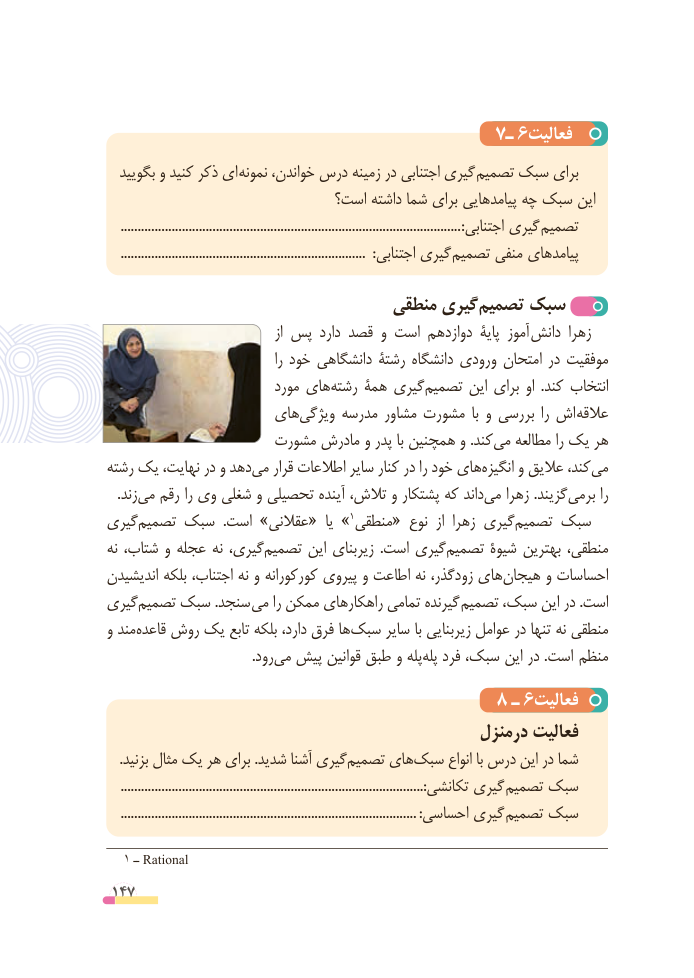

# PDF page 147

7ـ 6فعالیت
  بگویید و کنید ذکر ای نمونه خواندن، درس زمینه در اجتنابی گیری  تصمیم سبک برای
                             است؟ داشته شما برای پیامدهایی چه سبک این
    ....................................................................................................:اجتنابی گیری تصمیم
    ........................................................................  :اجتنابی گیری تصمیم منفی پیامدهای

                                منطقی گیری ‌تصمیم ‌سبک
                                        از پس دارد قصد و است دوازدهم پایة آموز  دانش زهرا
                                        را خود دانشگاهی رشتة دانشگاه ورودی امتحان در موفقیت
                           مورد های‌رشته همة گیریتصمیم‌      این برای او  .کند انتخاب
                    های ‌ویژگی مدرسه مشاور مشورت  با و بررسی  را اش عالقه
                    مشورت مادرش و پدر با همچنین و .کند ‌می مطالعه را یک هر
رشته یک نهایت، در و دهد می‌   قرار اطالعات سایر کنار در را خود هایانگیزه‌     و عالیق کند، ‌می
 .‌زندمی رقم را وی شغلی و تحصیلی آینده تالش، و پشتکار که داند‌می زهرا .گزیند‌برمی را
گیری ‌»تصمیم سبک  .است »عقالنی«  یا   1منطقی« نوع  از زهرا گیریتصمیم‌    سبک
نه شتاب، و عجله نه گیری،تصمیم‌      این زیربنای  .است گیری‌تصمیم شیوۀ بهترین منطقی،
اندیشیدن بلکه اجتناب، نه و کورکورانه پیروی و اطاعت نه زودگذر، های‌هیجان و احساسات
گیری‌تصمیم سبک .سنجد می را ممکن راهکارهای تمامی گیرنده تصمیم سبک، این در .است
و مند ‌قاعده روش یک تابع بلکه دارد، فرق ها ‌سبک سایر با زیربنایی عوامل در تنها نه منطقی
           .‌رودمی پیش قوانین طبق و پله‌پله فرد سبک، این در .است  منظم
                                      8 ـ 6فعالیت
                                               درمنزل فعالیت
.‌بزنید مثال یک هر برای .شدید آشنا گیریتصمیم هایسبک‌      انواع با درس این در شما
    .........................................................................................:تکانشی گیری تصمیم سبک
    .......................................................................................:احساسی گیری تصمیم سبک

  1 ــ Rational
 147

