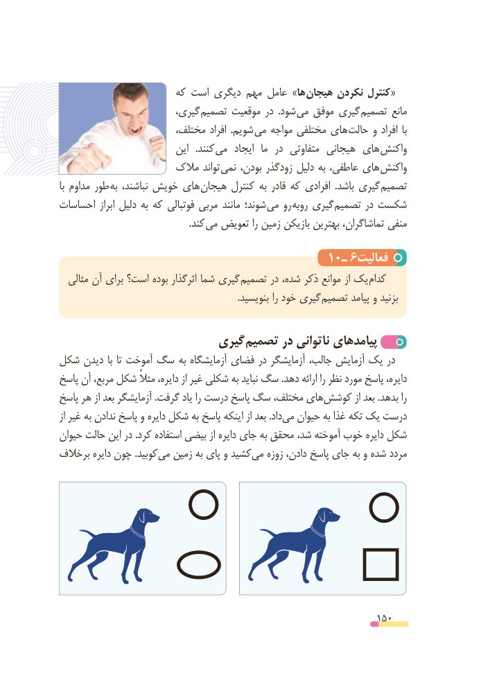

# PDF page 150

که است دیگری مهم عامل »ها هیجان نکردن کنترل«
                        گیری، تصمیم موقعیت در  .شود  می موفق گیری تصمیم مانع
                       مختلف، افراد  .شویم  می مواجه مختلفی های حالت و افراد  با
                           این   .کنند  می  ایجاد  ما  در  متفاوتی هیجانی های واکنش
                    مالک تواند نمی بودن، زودگذر دلیل به عاطفی، های واکنش
با مداوم طور  به نباشند، خویش های هیجان کنترل به قادر که افرادی  .باشد گیری  تصمیم
احساسات ابراز دلیل به که فوتبالی مربی مانند شوند؛ می رو روبه گیری تصمیم در شکست
              . کند می تعویض را زمین بازیکن بهترین تماشاگران، منفی

                                      10ـ 6فعالیت
  مثالی آن برای است؟ بوده اثرگذار شما گیری تصمیم در شده، ذکر موانع از یک  کدام
    . بنویسید را خود گیری تصمیم پیامد و بزنید

                        گیری تصمیم در ناتوانی پیامدهای
شکل دیدن با تا آموخت سگ به آزمایشگاه فضای در آزمایشگر جالب، آزمایش یک در
پاسخ آن مربع، شکل مثالً دایره، از غیر شکلی به نباید سگ .دهد ارائه را نظر مورد پاسخ دایره،
پاسخ هر از بعد آزمایشگر .گرفت یاد را درست پاسخ سگ مختلف، هایکوشش‌          از بعد .بدهد را
از غیر به ندادن پاسخ و دایره شکل به پاسخ اینکه از بعد .داد‌می حیوان به غذا تکه یک درست
حیوان حالت این در .کرد استفاده بیضی از دایره جای به محقق شد، آموخته خوب دایره شکل
برخالف دایره چون .کوبیدمی‌  زمین به پای و کشید‌می زوزه دادن، پاسخ جای به و شده مردد

                                                          150

