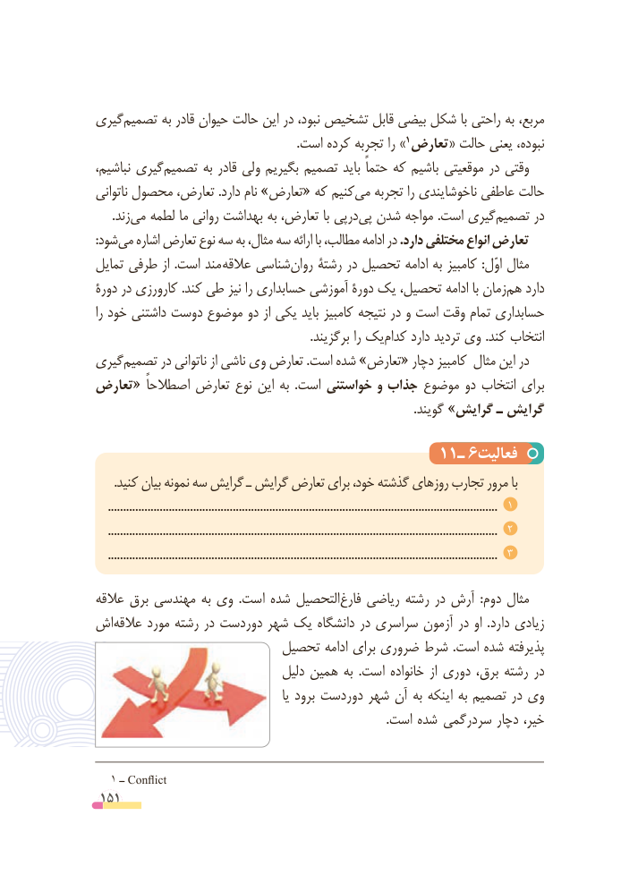

# PDF page 151

گیری‌تصمیم به قادر حیوان حالت این در نبود، تشخیص قابل بیضی شکل با راحتی به مربع،
    .1است کرده تجربه را » تعارض « حالت یعنی نبوده،
نباشیم، گیری‌تصمیم به قادر ولی بگیریم تصمیم باید حتماً که باشیم موقعیتی در وقتی
ناتوانی محصول تعارض، .دارد نام »تعارض« که کنیم‌می تجربه را ناخوشایندی عاطفی حالت
     .زند‌می لطمه ما روانی بهداشت به تعارض، با پی ‌در‌پی شدن مواجه .است گیری‌تصمیم در
:‌شودمی اشاره تعارض نوع سه به مثال، سه ارائه با مطالب، ادامه در .دارد مختلفی انواع تعارض
تمایل طرفی از  .است مند عالقه شناسی‌روان رشتة در تحصیل ادامه به کامبیز  :اوّل مثال
دورة در کارورزی .کند طی نیز را حسابداری آموزشی دورة یک تحصیل، ادامه با زمان ‌هم دارد
را خود داشتنی دوست موضوع دو از یکی باید کامبیز نتیجه در و است وقت تمام حسابداری
     .‌برگزیند را یککدام دارد تردید وی .کند انتخاب
گیری ‌تصمیم در ناتوانی از ناشی وی تعارض .است شده »تعارض« دچار کامبیز مثال این در
تعارض « اصطالحاً تعارض نوع این به  .است خواستنی و جذاب موضوع دو انتخاب برای
                                                                                                        .گویند »گرایش ـ گرایش

                                     11ـ 6فعالیت
      .کنید بیان نمونه سه گرایش ـ گرایش تعارض برای خود، گذشته روزهای تجارب مرور با
    ................................................................................................................................  1
    ................................................................................................................................  2
    ................................................................................................................................  3
عالقه برق مهندسی به وی  . است شده التحصیل ‌فارغ ریاضی رشته در آرش  : دوم مثال
اش‌عالقه مورد رشته در دوردست شهر یک دانشگاه در سراسری آزمون در او  . دارد زیادی
                         تحصیل ادامه برای ضروری شرط  . است شده پذیرفته
                                 دلیل همین به  . است خانواده از دوری برق، رشته در
                                                  یا برود دوردست شهر آن به اینکه به تصمیم در وی
          . است شده سردرگمی دچار خیر،

  1 ــ Conflict
 151

