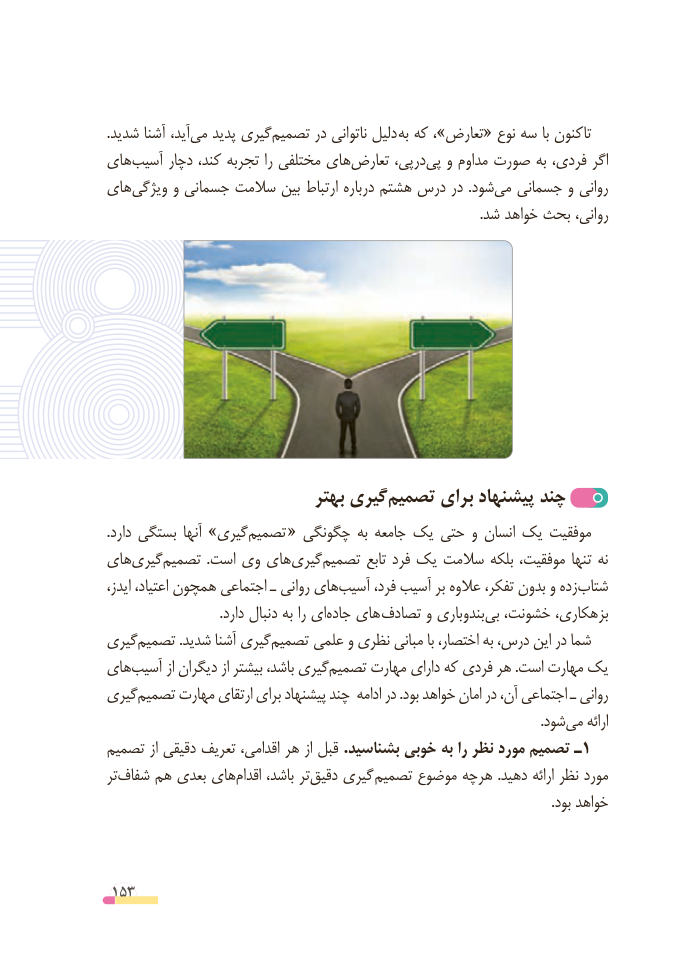

# PDF page 153

.شدید آشنا آید،‌می پدید گیریتصمیم‌      در ناتوانی دلیل  به که ،»تعارض« نوع سه با تاکنون
های‌آسیب دچار کند، تجربه را مختلفی های‌تعارض درپی،پی‌   و مداوم صورت به فردی، اگر
های‌ویژگی و جسمانی سالمت بین ارتباط درباره هشتم درس در  .شودمی‌  جسمانی و روانی
                                                                                                              .شد خواهد بحث روانی،

                            بهتر گیری‌تصمیم برای پیشنهاد چند
.دارد بستگی آنها »گیریتصمیم‌        « چگونگی به جامعه یک حتی و انسان یک موفقیت
های‌گیریتصمیم‌            .است وی هایگیری‌   تصمیم‌        تابع فرد یک سالمت بلکه موفقیت، تنها نه
ایدز، اعتیاد، همچون اجتماعی ـ روانی های‌آسیب فرد، آسیب بر عالوه تفکر، بدون و زده ‌شتاب
  .‌دارد دنبال به را ای جاده های تصادف و بندوباریبی‌  خشونت، بزهکاری،
گیریتصمیم‌           .شدید آشنا گیریتصمیم‌        علمی و نظری مبانی با اختصار، به درس، این در شما
هایآسیب‌       از دیگران از بیشتر باشد، گیریتصمیم‌     مهارت دارای که فردی هر .است مهارت یک
گیریتصمیم‌     مهارت ارتقای برای پیشنهاد چند ادامه در .بود خواهد امان در آن، اجتماعی ـ روانی
                             .‌شودمی ارائه
تصمیم از دقیقی تعریف اقدامی، هر از قبل .بشناسید خوبی به را نظر مورد تصمیم ـ1
ترشفاف‌    هم بعدی هایاقدام‌     باشد، تردقیق‌    گیری تصمیم موضوع هرچه .دهید ارائه نظر مورد
                                                                                                                                   .بود خواهد

 153

