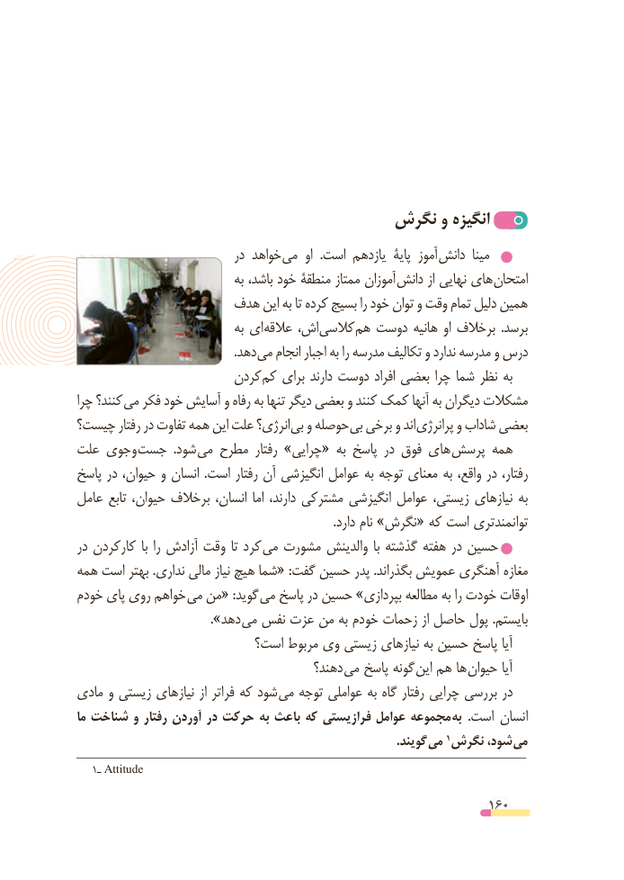

# PDF page 160

نگرش و انگیزه
                              در خواهد می  او  .است یازدهم  پایۀ آموز دانش  مینا
                                به باشد، خود منطقۀ ممتاز آموزان دانش از نهایی های امتحان
                  هدف این به تا کرده بسیج را خود توان و وقت تمام دلیل همین
                                به ای عالقه اش، کالسی هم دوست هانیه او برخالف  .برسد
            . دهد می انجام اجبار به را مدرسه تکالیف و ندارد مدرسه و درس
                       کردن کم برای دارند دوست افراد بعضی چرا شما نظر به
چرا کنند؟ می فکر خود آسایش و رفاه به تنها دیگر بعضی و کنند کمک آنها به دیگران مشکالت
چیست؟ رفتار در تفاوت همه این علت انرژی؟ بی و حوصله بی برخی و اند پرانرژی و شاداب بعضی
علت وجوی جست  .شود می مطرح رفتار »چرایی« به پاسخ در فوق های پرسش همه
پاسخ در حیوان، و انسان  .است رفتار آن انگیزشی عوامل به توجه معنای به واقع، در رفتار،
عامل تابع حیوان، برخالف انسان، اما دارند، مشترکی انگیزشی عوامل زیستی، نیازهای به
                                                                                    .دارد نام »نگرش« که است توانمندتری
در کارکردن  با را آزادش وقت تا کرد  می مشورت والدینش  با گذشته هفته در حسین
همه است بهتر .نداری مالی نیاز هیچ شما« :گفت حسین پدر .بگذراند عمویش آهنگری مغازه
خودم پای روی خواهم می من« :گوید می پاسخ در حسین »بپردازی مطالعه به را خودت اوقات
                         ».دهد می نفس عزت من به خودم زحمات از حاصل پول .بایستم
                         است؟ مربوط وی زیستی نیازهای به حسین پاسخ آیا
                                        دهند؟ می پاسخ گونه این هم ها حیوان آیا
مادی و زیستی نیازهای از فراتر که شود  می توجه عواملی به گاه رفتار چرایی بررسی در
ما شناخت و رفتار آوردن در حرکت به باعث که فرازیستی عوامل مجموعه  به  .است انسان
                   . گویند می 1 نگرش شود، می
   1ـ Attitude

                                                          160

