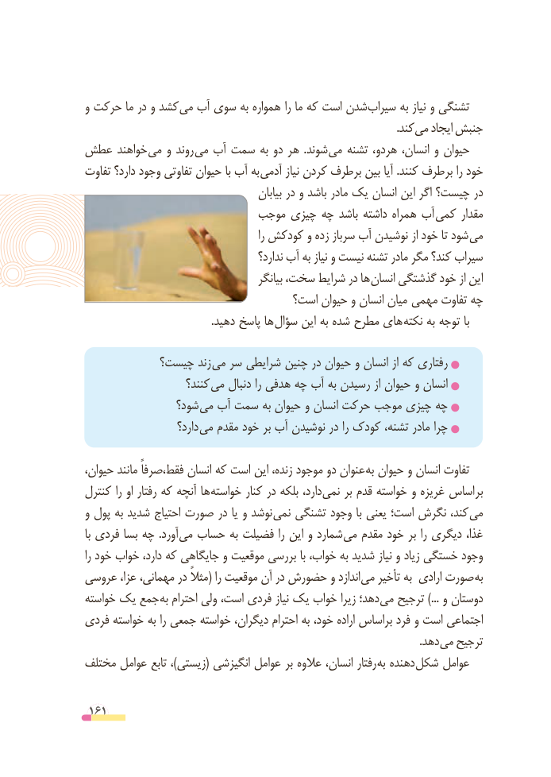

# PDF page 161

و حرکت ما در و کشد می آب سوی به همواره را ما که است شدن سیراب به نیاز و تشنگی
                                                                                                                   .کند می ایجاد جنبش
عطش خواهند می و روند می آب سمت به دو هر  .شوند می تشنه هردو، انسان، و حیوان
تفاوت دارد؟ وجود تفاوتی حیوان با آب به آدمی نیاز کردن برطرف بین آیا .کنند برطرف را خود
                                            بیابان در و باشد مادر یک انسان این اگر چیست؟ در
                         موجب چیزی چه باشد داشته همراه آب کمی مقدار
                                                    را کودکش و زده سرباز آب نوشیدن از خود تا شود می
                                          ندارد؟ آب به نیاز و نیست تشنه مادر مگر کند؟ سیراب
                                          بیانگر سخت، شرایط در ها انسان گذشتگی خود از این
                                 است؟ حیوان و انسان میان  مهمی تفاوت چه
    . دهید پاسخ ها سؤال این به شده مطرح های نکته به توجه با

           چیست؟ زند  می سر شرایطی چنین در حیوان و انسان از که رفتاری
                     کنند؟ می دنبال را هدفی چه آب به رسیدن از حیوان و انسان
                شود؟  می آب سمت به حیوان و انسان حرکت موجب چیزی چه
                     دارد؟ می مقدم خود بر آب نوشیدن در را کودک تشنه، مادر چرا

،عنوانحیوان مانند فقط،صرفاً انسان که است این زنده، موجود دو         به حیوان و انسان تفاوت
کنترل را او رفتار که آنچه ها خواسته کنار در بلکه دارد، نمی بر قدم خواسته و غریزه اساس بر
و پول به شدید احتیاج صورت در یا و نوشد نمی تشنگی وجود با یعنی است؛ نگرش کند، می
با فردی بسا چه  .آورد می حساب به فضیلت را این و شمارد می مقدم خود بر را دیگری غذا،
را خود خواب دارد، که جایگاهی و موقعیت بررسی با خواب، به شدید نیاز و زیاد خستگی وجود
عروسی عزا، مهمانی، در مثالً( را موقعیت آن در حضورش و اندازد می تأخیر به ارادی صورت به
خواسته یک جمع به احترام ولی است، فردی نیاز یک خواب زیرا دهد؛ می ترجیح ...) و دوستان
فردی خواسته به را جمعی خواسته دیگران، احترام به خود، اراده براساس فرد و است اجتماعی
                             . دهد می ترجیح
مختلف عوامل تابع ،)زیستی( انگیزشی عوامل بر عالوه انسان، رفتار به دهنده شکل عوامل

 161

