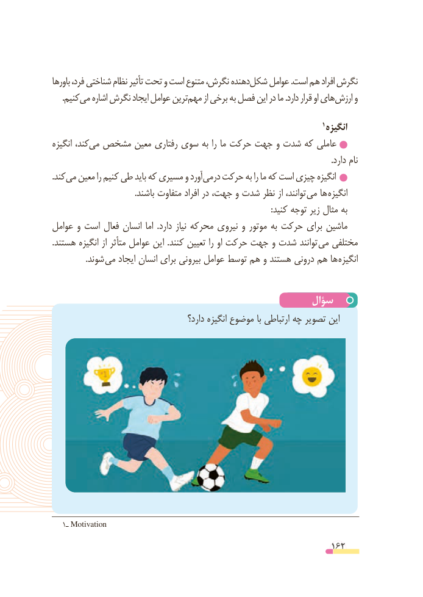

# PDF page 162

باورها فرد، شناختی نظام تأثیر تحت و است متنوع نگرش، دهنده شکل عوامل .است هم افراد نگرش
 . کنیممی اشاره نگرش ایجاد عوامل ترین مهم از برخی به فصل این در ما .دارد قرار او های ارزش و

                                                                               1 انگیزه
انگیزه کند،می  مشخص معین رفتاری سوی به را ما حرکت جهت و شدت که عاملی
                                                                                                                                       .دارد نام
. کندمی معین را کنیم طی باید که مسیری و آورد می در حرکت به را ما که است چیزی انگیزه
                                        .باشند متفاوت افراد در جهت، و شدت نظر از توانند، می ها انگیزه
                                                                                                         :کنید توجه زیر مثال به
عوامل و است فعال انسان اما  .دارد نیاز محرکه نیروی و موتور به حرکت برای ماشین
.هستند انگیزه از متأثر عوامل این .کنند تعیین را او حرکت جهت و شدت توانند می مختلفی
                .شوند  می ایجاد انسان برای بیرونی عوامل توسط هم و هستند درونی هم ها انگیزه

                                                سؤال
                                         دارد؟ انگیزه موضوع با ارتباطی چه تصویر این

   1ـ Motivation

                                                          162

