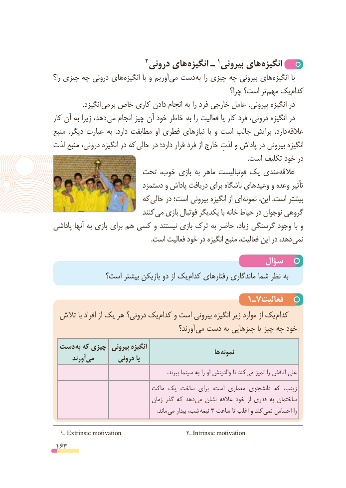

# PDF page 163

2 درونی های انگیزه ـ 1 بیرونی های  انگیزه
را؟ چیزی چه درونی های انگیزه با و آوریم می دست به را چیزی چه بیرونی های انگیزه با
                                                            چرا؟ است؟ تر مهم یک کدام
   . انگیزد می بر خاص کاری دادن انجام به را فرد خارجی عامل بیرونی، انگیزه در
کار آن به زیرا دهد، می انجام چیز آن خود خاطر به را فعالیت یا کار فرد درونی، انگیزه در
منبع دیگر، عبارت به  .دارد مطابقت او فطری های  نیاز  با و است جالب برایش دارد،  عالقه
لذت منبع درونی، انگیزه در که  حالی در دارد؛ قرار فرد از خارج لذتِ و پاداش در بیرونی انگیزه
                                                                                                                   .است تکلیف خود در
                   تحت خوب، بازی به ماهر فوتبالیست یک مندی عالقه
                          دستمزد و پاداش دریافت برای باشگاه های وعید و وعده تأثیر
                        که حالی در است؛ بیرونی انگیزه از ای نمونه این، .است بیشتر
                              کنند می بازی فوتبال یکدیگر با خانه حیاط در نوجوان گروهی
پاداشی آنها به بازی برای هم کسی و نیستند بازی ترک به حاضر زیاد، گرسنگی وجود با و
                                                          .است فعالیت خود در انگیزه منبع فعالیت، این در دهد، نمی
                                                سؤال
             است؟ بیشتر بازیکن دو از یک  کدام رفتارهای ماندگاری شما نظر به

                                      1ـ7فعالیت
  تالش با افراد از یک هر درونی؟ یک  کدام و است بیرونی انگیزه زیر موارد از یک کدام
                                              آورند؟ می دست به چیزهایی یا چیز چه خود
 دست  به که چیزی  بیرونی انگیزه                                                         ها نمونه       آورند می       درونی یا
   . ببرند سینما به را او والدینش تا کند می تمیز را اتاقش علی
                               ماکت یک ساخت برای است، معماری دانشجوی که زینب،
                                     زمان گذر که دهد می نشان عالقه خود  از قدری به ساختمان
                                                                           .ماند  می بیدار شب، نیمه 3 ساعت تا اغلب و کند نمی احساس را

  1ـ Extrinsic motivation                      2ـ Intrinsic motivation
 163

