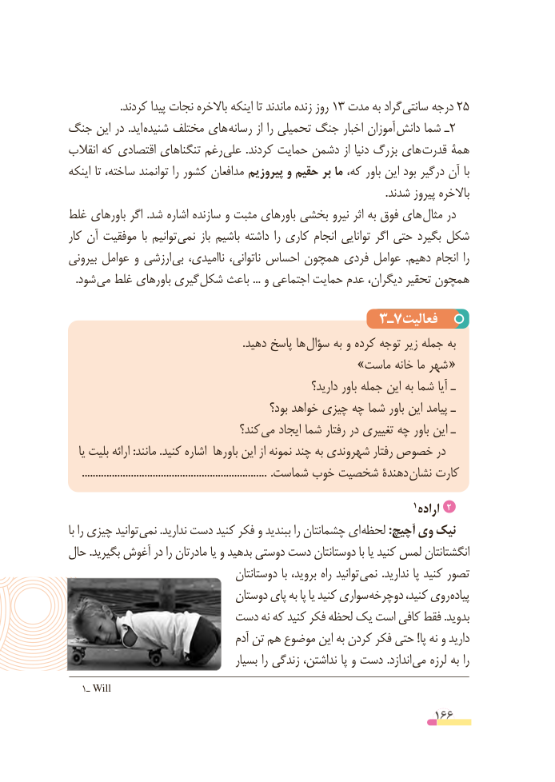

# PDF page 166

.کردند پیدا نجات باالخره اینکه تا ماندند زنده روز 13 مدت به گراد سانتی درجه 25
جنگ این در .اید شنیده مختلف های رسانه از را تحمیلی جنگ اخبار آموزان دانش شما ـ2
انقالب که اقتصادی تنگناهای رغم علی .کردند حمایت دشمن از دنیا بزرگ های قدرت همۀ
اینکه تا ساخته، توانمند را کشور مدافعان پیروزیم و حقیم بر ما که، باور این بود درگیر آن با
                                                                                                                     .شدند پیروز باالخره
غلط باورهای اگر .شد اشاره سازنده و مثبت باورهای بخشی نیرو اثر به فوق های مثال در
کار آن موفقیت  با توانیم نمی باز باشیم داشته را کاری انجام توانایی اگر حتی بگیرد شکل
بیرونی عوامل و ارزشی بی ناامیدی، ناتوانی، احساس همچون فردی عوامل  .دهیم انجام را
 . شود می غلط باورهای گیری شکل باعث ... و اجتماعی حمایت عدم دیگران، تحقیر همچون

                                      3ـ7فعالیت
     . دهید پاسخ ها سؤال به و کرده توجه زیر جمله به
         » «ماست خانه ما شهر
                                                       دارید؟ باور جمله این به شما آیا ـ
                                            بود؟ خواهد چیزی چه شما باور این پیامد ـ
                                 کند؟ می ایجاد شما رفتار در تغییری چه باور این ـ
   یا بلیت ارائه :مانند .کنید اشاره باورها این از نمونه چند به شهروندی رفتار خصوص در
   .................................................................... .شماست خوب شخصیت دهندۀ نشان کارت

                                                                             1 اراده 2
با را چیزی توانید نمی .ندارید دست کنید فکر و ببندید را چشمانتان ای لحظه :آچیچ وی نیک
حال .بگیرید آغوش در را مادرتان یا و بدهید دوستی دست دوستانتان با یا کنید لمس انگشتانتان
                                    دوستانتان با بروید، راه توانید نمی .ندارید پا کنید تصور
                               دوستان پای به پا یا کنید سواری دوچرخه کنید، روی پیاده
                      دست نه که کنید فکر لحظه یک است کافی فقط .بدوید
                                    آدم تن هم موضوع این به کردن فکر حتی !پا نه و دارید
                                     بسیار را زندگی نداشتن، پا و دست .اندازد می لرزه به را
   1ـ Will
                                                          166

