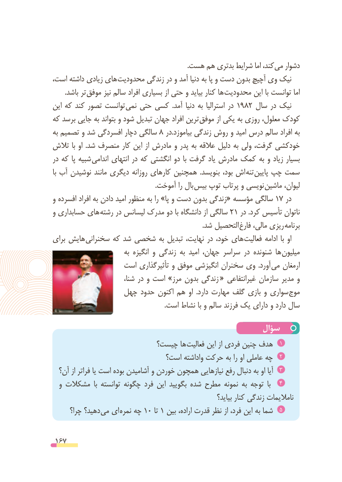

# PDF page 167

.هست هم بدتری شرایط اما کند، می دشوار
است، داشته زیادی های  محدودیت زندگی در و آمد دنیا به پا و دست بدون آچیچ وی نیک
 . باشد تر موفق نیز سالم افراد بسیاری از حتی و بیاید کنار ها محدودیت این با توانست اما
این که کند تصور توانست  نمی حتی کسی  .آمد دنیا به استرالیا در 1982 سال در نیک
که برسد جایی به بتواند و شود تبدیل جهان افراد ترین  موفق از یکی به روزی معلول، کودک
به تصمیم و شد افسردگی دچار سالگی 8 در.بیاموزد زندگی روش و امید درس سالم افراد به
تالش با او  .شد منصرف کار این از مادرش و پدر به عالقه دلیل به ولی گرفت، خودکشی
در که پا شبیه اندامی انتهای در که انگشتی دو  با گرفت یاد مادرش کمک به و زیاد بسیار
با آب نوشیدن مانند دیگری روزانه کارهای همچنین  .بنویسد بود، اش تنه پایین چپ سمت
     . آموخت را بال بیس توپ پرتاب و نویسی ماشین لیوان،
و افسرده افراد به دادن امید منظور به را »پا و دست بدون زندگی« مؤسسه سالگی 17 در
و حسابداری های رشته در لیسانس مدرک دو با دانشگاه از سالگی 21 در .کرد تأسیس ناتوان
        . شد التحصیل فارغ مالی، ریزی برنامه
برای هایش سخنرانی که شد شخصی به تبدیل نهایت، در خود، های فعالیت ادامه  با او
                          به انگیزه و زندگی به امید جهان، سراسر در شنونده ها  میلیون
                 است تأثیرگذاری و موفق انگیزشی سخنران وی  .آورد  می ارمغان
                           شنا، در و است »مرز بدون زندگی « غیرانتفاعی سازمان مدیر و
                چهل حدود اکنون هم او  .دارد مهارت گلف بازی و سواری موج
                                                                   .است نشاط با و سالم فرزند یک دارای و دارد سال

                                                سؤال
                        چیست؟ ها فعالیت این از فردی چنین هدف  1
                             است؟ واداشته حرکت به را او عاملی چه  2
  آن؟ از فراتر یا است بوده آشامیدن و خوردن همچون نیازهایی رفع دنبال به او آیا  3
  و مشکالت  با توانسته چگونه فرد این بگویید شده مطرح نمونه به توجه  با   4
                                                                  بیاید؟ کنار زندگی نامالیمات
      چرا؟ دهید؟ می ای نمره چه 10 تا 1 بین اراده، قدرت نظر از فرد، این به شما  5

 167

