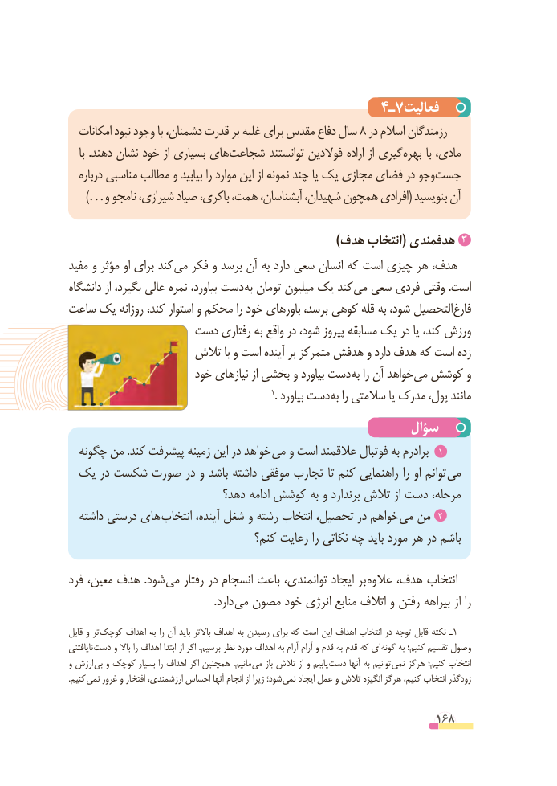

# PDF page 168

4ـ7فعالیت
  امکانات نبود وجود با دشمنان، قدرت بر غلبه برای مقدس دفاع سال 8 در اسالم رزمندگان
   با .دهند نشان خود از بسیاری های شجاعت توانستند فوالدین اراده از گیری بهره با مادی،
   درباره مناسبی مطالب و بیابید را موارد این از نمونه چند یا یک مجازی فضای در وجو جست
  …)و نامجو شیرازی، صیاد باکری، همت، آبشناسان، شهیدان، همچون افرادی( بنویسید آن

                                                                )هدف انتخاب( هدفمندی 3
مفید و مؤثر او برای کند می فکر و برسد آن به دارد سعی انسان که است چیزی هر هدف،
دانشگاه از بگیرد، عالی نمره بیاورد، دست به تومان میلیون یک کند می سعی فردی وقتی .است
ساعت یک روزانه کند، استوار و محکم را خود باورهای برسد، کوهی قله به شود، التحصیل فارغ
                دست رفتاری به واقع در شود، پیروز مسابقه یک در یا کند، ورزش
                   تالش با و است آینده بر متمرکز هدفش و دارد هدف که است زده
                      خود نیازهای از بخشی و بیاورد دست به را آن خواهد می کوشش و
                                                                  1. بیاورد دست به را سالمتی یا مدرک پول، مانند
                                                سؤال
  چگونه من .کند پیشرفت زمینه این در خواهد  می و است عالقمند فوتبال به برادرم  1
 یک در شکست صورت در و باشد داشته موفقی تجارب تا کنم راهنمایی را او توانم می
                           دهد؟ ادامه کوشش به و برندارد تالش از دست مرحله،
  داشته درستی های انتخاب آینده، شغل و رشته انتخاب تحصیل، در خواهم می من  2
                                  کنم؟ رعایت را نکاتی چه باید مورد هر در باشم

فرد معین، هدف .شود می رفتار در انسجام باعث توانمندی، ایجاد بر عالوه هدف، انتخاب
                                                     .دارد می مصون خود انرژی منابع اتالف و رفتن بیراهه از را
قابل و تر کوچک اهداف به را آن باید باالتر اهداف به رسیدن برای که است این اهداف انتخاب در توجه قابل نکته ـ 1
نایافتنی دست و باال را اهداف ابتدا از اگر .برسیم نظر مورد اهداف به آرام آرام و قدم به قدم که ای گونه به کنیم؛ تقسیم وصول
و ارزش بی و کوچک بسیار را اهداف اگر همچنین .مانیم می باز تالش از و یابیم دست آنها به توانیم نمی هرگز کنیم؛ انتخاب
.کنیم نمی غرور و افتخار ارزشمندی، احساس آنها انجام از زیرا شود؛ نمی ایجاد عمل و تالش انگیزه هرگز کنیم، انتخاب زودگذر

                                                          168

