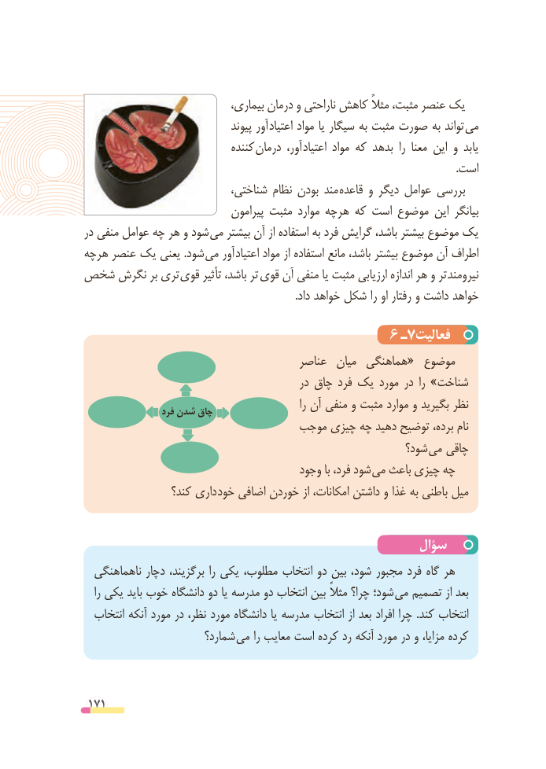

# PDF page 171

،یکبیماری درمان و ناراحتی کاهش مثالً مثبت، عنصر
                                   پیوند آور اعتیاد مواد یا سیگار به مثبت صورت به تواند می
                               کننده درمان آور، اعتیاد مواد که بدهد  را معنا این و یابد
                                                                                                                                           .است
                            شناختی، نظام بودن مند قاعده و دیگر عوامل بررسی
                               پیرامون مثبت موارد هرچه که است موضوع این بیانگر
در منفی عوامل چه هر و شود می بیشتر آن از استفاده به فرد گرایش باشد، بیشتر موضوع یک
هرچه عنصر یک یعنی .شود می آور اعتیاد مواد از استفاده مانع باشد، بیشتر موضوع آن اطراف
شخص نگرش بر تری قوی تأثیر باشد، تر قوی آن منفی یا مثبت ارزیابی اندازه هر و تر  نیرومند
                                                                               .داد خواهد شکل را او رفتار و داشت خواهد

                                      6 ـ7فعالیت
                                       عناصر  میان  هماهنگی«  موضوع
                                              در چاق فرد یک مورد در  را »شناخت
                                                                 را آن منفی و مثبت موارد و بگیرید نظر                   فرد شدن چاق
                               موجب چیزی چه دهید توضیح برده، نام
                                                         شود؟ می چاقی
                                       وجود با فرد، شود می باعث چیزی چه
                 کند؟ داری خود اضافی خوردن از امکانات، داشتن و غذا به باطنی میل

                                                سؤال
  ناهماهنگی دچار برگزیند، را یکی مطلوب، انتخاب دو بین شود، مجبور فرد گاه هر
   را یکی باید خوب دانشگاه دو یا مدرسه دو انتخاب بین مثالً چرا؟ شود؛ می تصمیم از بعد
  انتخاب آنکه مورد در نظر، مورد دانشگاه یا مدرسه انتخاب از بعد افراد چرا .کند انتخاب
                       شمارد؟ می را معایب است کرده رد آنکه مورد در و مزایا، کرده

 171

