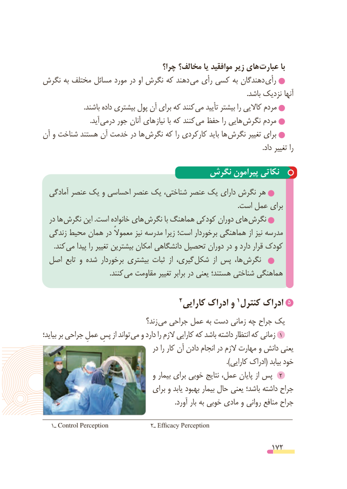

# PDF page 172

چرا؟ مخالف؟ یا موافقید زیر های عبارت با
نگرش به مختلف مسائل مورد در او نگرش که دهند می رأی کسی به دهندگان رأی
                                                                                                                        .باشد نزدیک آنها
 . باشند داده بیشتری پول آن برای که کنند می تأیید بیشتر را کاالیی مردم
                            .آید  درمی جور آنان های  نیاز با که کنند  می حفظ را هایی نگرش مردم
آن و شناخت هستند آن خدمت در ها  نگرش که را کارکردی باید ها  نگرش تغییر برای
                                                                                                                                 .داد تغییر را

                               نگرش پیرامون نکاتی
  آمادگی عنصر یک و احساسی عنصر یک شناختی، عنصر یک دارای نگرش هر
                                                                                                                   .است عمل برای
  در ها نگرش این .است خانواده های نگرش با هماهنگ کودکی دوران های نگرش
  زندگی محیط همان در معموالً نیز مدرسه زیرا است؛ برخوردار هماهنگی از نیز مدرسه
       .کند  می پیدا را تغییر بیشترین امکان دانشگاهی تحصیل دوران در و دارد قرار کودک
 اصل تابع و شده برخوردار بیشتری ثبات  از گیری، شکل  از پس ها،  نگرش
                                       .کنند می مقاومت تغییر برابر در یعنی هستند؛ شناختی هماهنگی

                                                                             5                                          2 کارایی ادراک و 1 کنترل ادراک
                                    زند؟  می جراحی عمل به دست زمانی چه جراح یک
بیاید؛ بر جراحی عملِ پسِ از تواند می و دارد را الزم کارایی که باشد داشته انتظار که زمانی 1
                                     در را کار آن دادن انجام در الزم مهارت و دانش یعنی
                                                                                               ).کارایی ادراک( بیابد خود
                                   و بیمار برای خوبی نتایج عمل، پایان از پس  2
                                  برای و یابد بهبود بیمار حال یعنی باشد؛ داشته جراح
                                                                              .آورد بار به خوبی مادی و روانی منافع جراح

   1ـ Control Perception              2ـ Efficacy Perception

                                                          172

