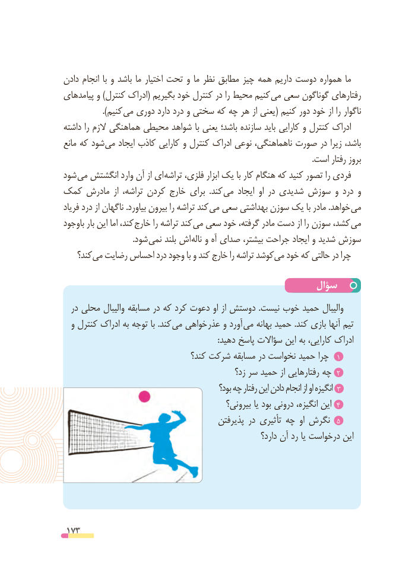

# PDF page 173

دادن انجام  با و باشد ما اختیار تحت و ما نظر مطابق چیز همه داریم دوست همواره ما
پیامدهای و )کنترل ادراک( بگیریم خود کنترل در را محیط کنیم می سعی گوناگون رفتارهای
                 ).کنیم می دوری دارد درد و سختی که چه هر از یعنی( کنیم دور خود از را ناگوار
داشته را الزم هماهنگی محیطی شواهد با یعنی باشد؛ سازنده باید کارایی و کنترل ادراک
مانع که شود می ایجاد کاذب کارایی و کنترل ادراک نوعی ناهماهنگی، صورت در زیرا باشد،
                                                                                                                           .است رفتار بروز
شود می انگشتش وارد آن از ای تراشه فلزی، ابزار یک با کار هنگام که کنید تصور را فردی
کمک مادرش  از تراشه، کردن خارج برای  .کند  می ایجاد او در شدیدی سوزش و درد و
فریاد درد از ناگهان .بیاورد بیرون را تراشه کند  می سعی بهداشتی سوزن یک با مادر .خواهد می
باوجود بار این اما کند، خارج را تراشه کند می سعی خود گرفته، مادر دست از را سوزن کشد،  می
                                  .شود نمی بلند اش ناله و آه صدای بیشتر، جراحت ایجاد و شدید سوزش
    کند؟ می رضایت احساس درد وجود با و کند خارج را تراشه کوشد می خود که حالتی در چرا

                                                سؤال
  در محلی والیبال مسابقه در که کرد دعوت او از دوستش .نیست خوب حمید والیبال
  و کنترل ادراک به توجه با .کند می خواهی عذر و آورد می بهانه حمید .کند بازی آنها تیم
                                                                            :دهید پاسخ سؤاالت این به کارایی، ادراک
                                 کند؟ شرکت مسابقه در نخواست حمید چرا  1
                                                زد؟ سر حمید از رفتارهایی چه  2
                                                  بود؟ چه رفتار این دادن انجام از او انگیزه 3
                                              بیرونی؟ یا بود درونی انگیزه، این 4
                                          پذیرفتن در تأثیری چه  او نگرش  5
                                                             دارد؟ آن رد یا درخواست این

 173

