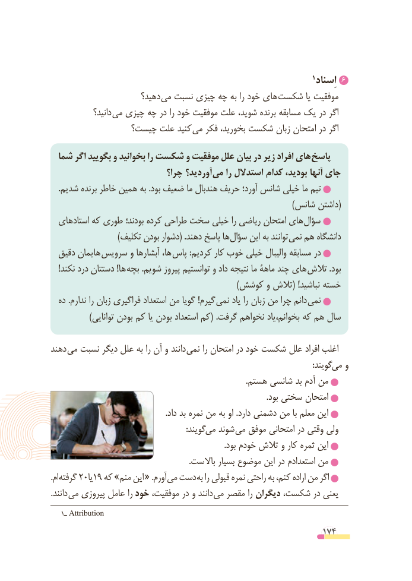

# PDF page 174

6                                                                         1 اِسناد
                       دهید؟ می نسبت چیزی چه به را خود های شکست یا موفقیت
              دانید؟ می چیزی چه در را خود موفقیت علت شوید، برنده مسابقه یک در اگر
                چیست؟ علت کنید می فکر بخورید، شکست زبان امتحان در اگر

  شما اگر بگویید و بخوانید را شکست و موفقیت علل بیان در زیر افراد های پاسخ
                            چرا؟ آوردید؟ می را استدالل کدام بودید، آنها جای
    .شدیم برنده خاطر همین به .بود ضعیف ما هندبال حریف آورد؛ شانس خیلی ما تیم
          )(شانس داشتن
  های استاد که طوری بودند؛ کرده طراحی سخت خیلی را ریاضی امتحان های سؤال
                         )تکلیف بودن دشوار( .دهند پاسخ ها سؤال این به توانند نمی هم دانشگاه
  دقیق هایمان  سرویس و آبشارها ها،  پاس :کردیم کار خوب خیلی والیبال مسابقه در
    !نکند درد دستتان !ها  بچه .شویم پیروز توانستیم و داد نتیجه ما ماهۀ چند های تالش .بود
                                                                      )کوشش و تالش( !نباشید خسته
  ده .ندارم را زبان فراگیری استعداد من گویا !گیرم  نمی یاد را زبان من چرا دانم نمی
              )توانایی بودن کم یا بودن استعداد کم( .گرفت نخواهم بخوانم،یاد که هم سال

دهند می نسبت دیگر علل به را آن و دانند  نمی را امتحان در خود شکست علل افراد اغلب
                        : گویندمی و
                                                                                                 .هستم شانسی بد آدم من
                                                                                                           .بود سختی امتحان
                                                         .داد بد نمره من به او .دارد دشمنی من با معلم این
                                                                   :گویند می شوند می موفق امتحانی در وقتی ولی
                                                                                      .بود خودم تالش و کار ثمره این
                                                                    .باالست بسیار موضوع این در استعدادم من
.ام گرفته 20یا19 که »منم این « .آورم می دست به را قبولی نمره راحتی به کنم، اراده من اگر
.دانند می پیروزی عامل را خود موفقیت، در و دانند  می مقصر را دیگران شکست، در یعنی
   1ـ Attribution
                                                          174

