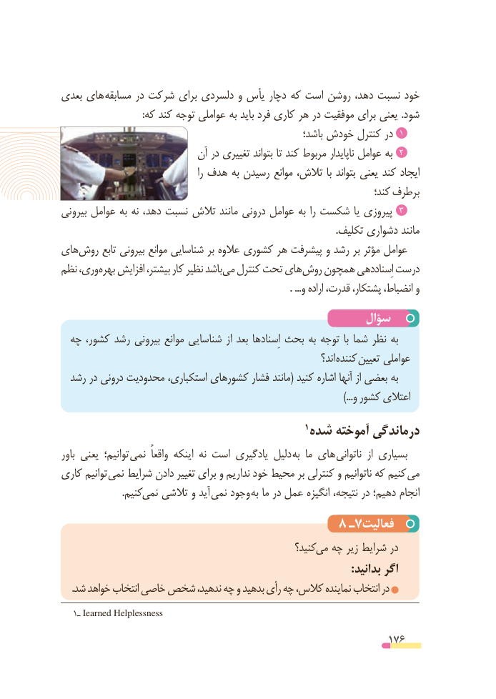

# PDF page 176

بعدی های مسابقه در شرکت برای دلسردی و یأس دچار که است روشن دهد، نسبت خود
                                 :که کند توجه عواملی به باید فرد کاری هر در موفقیت برای یعنی .شود
                                                            باشد؛ خودش کنترل در 1
                           آن در تغییری بتواند تا کند مربوط ناپایدار عوامل به  2
                                               را هدف به رسیدن موانع تالش، با بتواند یعنی کند ایجاد
                                                                            کند؛ برطرف
بیرونی عوامل به نه دهد، نسبت تالش مانند درونی عوامل به را شکست یا پیروزی  3
                                                                                                                 .تکلیف دشواری مانند
های روش تابع بیرونی موانع شناسایی بر عالوه کشوری هر پیشرفت و رشد بر مؤثر عوامل
نظم وری، بهره افزایش بیشتر، کار نظیر باشد می کنترل تحت های روش همچون اِسناددهی درست
                                                                                              . ...و اراده قدرت، پشتکار، انضباط، و
                                                سؤال
  چه کشور، رشد بیرونی موانع شناسایی از بعد اِسنادها بحث به توجه  با شما نظر به
                                                                         اند؟ کننده تعیین عواملی
  رشد در درونی محدودیت استکباری، کشورهای فشار مانند( کنید اشاره آنها از بعضی به
                                                                                                                     ...)و کشور اعتالی
                                                    1 شده آموخته درماندگی
باور یعنی توانیم؛  نمی  واقعاً اینکه نه است یادگیری دلیل به ما های  ناتوانی  از بسیاری
کاری توانیم نمی  شرایط دادن تغییر برای و نداریم خود محیط بر کنترلی و ناتوانیم که کنیم می
     . کنیمنمی تالشی و آید نمی وجود به ما در عمل انگیزه نتیجه، در دهیم؛ انجام
                                      8 ـ7فعالیت
                                                      کنید؟ می چه زیر شرایط در
                                                                                             :بدانید اگر
    .شد خواهد انتخاب خاصی شخص ندهید، چه و بدهید رأی چه کالس، نماینده انتخاب در
   1ـ Iearned Helplessness

                                                          176

