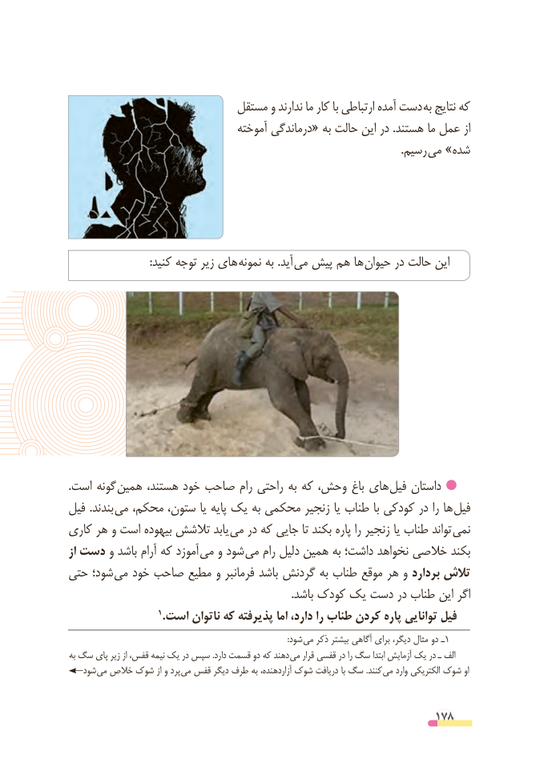

# PDF page 178

مستقل و ندارند ما کار با ارتباطی آمده دست  به نتایج که
                                  آموخته درماندگی« به حالت این در .هستند ما عمل از
                                                                                                                          .رسیم می »شده

                              :کنید توجه زیر های  نمونه به .آید  می پیش هم ها حیوان در حالت این

.است گونه  همین هستند، خود صاحب رام راحتی به که وحش، باغ های فیل داستان
فیل .بندند  می محکم، ستون، یا پایه یک به محکمی زنجیر یا طناب با کودکی در را ها  فیل
کاری هر و است بیهوده تالشش یابد  می در که جایی تا بکند پاره را زنجیر یا طناب تواند نمی
از دست و باشد آرام که آموزد  می و شود می رام دلیل همین به داشت؛ نخواهد خالصی بکند
حتی شود؛ می خود صاحب مطیع و فرمانبر باشد گردنش به طناب موقع هر و بردارد تالش
                                                                                  .باشد کودک یک دست در طناب این اگر
                     ١ .است ناتوان که پذیرفته اما دارد، را طناب کردن پاره توانایی فیل
                                                                                                            :شود می ذکر بیشتر آگاهی برای دیگر، مثال دو ـ1
به سگ پای زیر از قفس، نیمه یک در سپس .دارد قسمت دو که دهند می قرار قفسی در را سگ ابتدا آزمایش یک در ـ الف
   شود می خالص شوک از و پرد می قفس دیگر طرف به آزاردهنده، شوک دریافت با سگ .کنند می وارد الکتریکی شوک او

                                                          178

