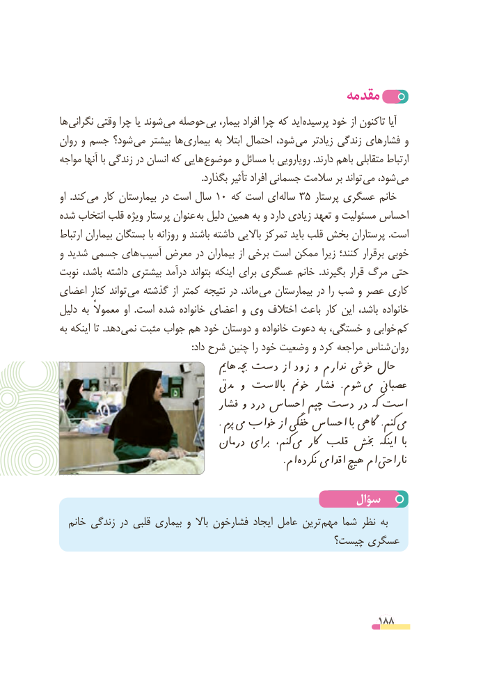

# PDF page 188

مقدمه
ها نگرانی وقتی چرا یا شوند می حوصله بی بیمار، افراد چرا که اید پرسیده خود از تاکنون آیا
روان و جسم شود؟ می بیشتر ها بیماری به ابتال احتمال شود، می زیادتر زندگی فشارهای و
مواجه آنها با زندگی در انسان که هایی موضوع و مسائل با رویارویی .دارند باهم متقابلی ارتباط
  . بگذارد تأثیر افراد جسمانی سالمت بر تواند می شود، می
او  .کند می کار بیمارستان در است سال 10 که است ای ساله 35 پرستار عسگری خانم
شده انتخاب قلب ویژه پرستار عنوان به دلیل همین به و دارد زیادی تعهد و مسئولیت احساس
ارتباط بیماران بستگان با روزانه و باشند داشته باالیی تمرکز باید قلب بخش پرستاران .است
و شدید جسمی های  آسیب معرض در بیماران از برخی است ممکن زیرا کنند؛ برقرار خوبی
نوبت باشد، داشته بیشتری درآمد بتواند اینکه برای عسگری خانم  .بگیرند قرار مرگ حتی
اعضای کنار تواند  می گذشته از کمتر نتیجه در  .ماند  می بیمارستان در را شب و عصر کاری
دلیل به معموالً او  .است شده خانواده اعضای و وی اختالف باعث کار این باشد، خانواده
به اینکه تا .دهد نمی مثبت جواب هم خود دوستان و خانواده دعوت به خستگی، و خوابی  کم
 : داد شرح چنین را خود وضعیت و کرد مراجعه شناس روان
                                    هامی چبه دست از زود و ندارم خویش حال
                                         دمیت و باالست خومن فشار  .شوم یم عصباین
                                 فشار و درد احساس چپم دست در که است
                                                         . پرم یم خواب از خفگی احساس با اگیه .کنم یم
                              درمان برای کنم،  یم اکر قلب خبش اینکه  با
                             . ام نکرده اقدایم هیچ ام ناراحیت

                                                سؤال
  خانم زندگی در قلبی بیماری و باال فشارخون ایجاد عامل ترین مهم شما نظر به
                                              چیست؟ عسگری

                                                          188

