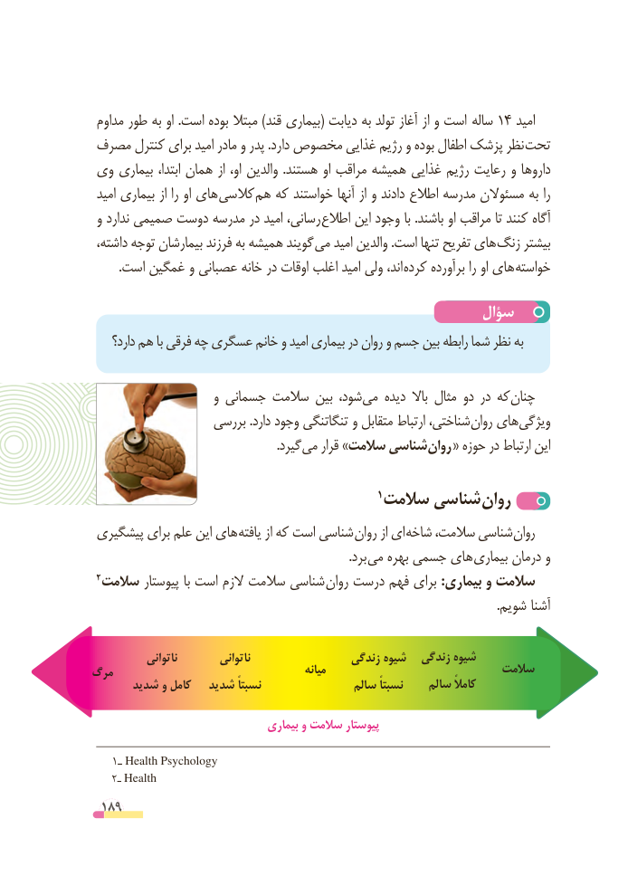

# PDF page 189

مداوم طور به او .است بوده مبتال )قند بیماری( دیابت به تولد آغاز از و است  ساله 14 امید
 مصرف کنترل برای امید مادر و پدر .دارد مخصوص غذایی رژیم و بوده اطفال پزشک نظر تحت
 وی بیماری ابتدا، همان از او، والدین  .هستند او مراقب همیشه غذایی رژیم رعایت و داروها
 امید بیماری از را او های کالسی هم که خواستند آنها از و دادند اطالع مدرسه مسئوالن به را
 و ندارد صمیمی دوست مدرسه در امید رسانی، اطالع این وجود با .باشند او مراقب تا کنند آگاه
 داشته، توجه بیمارشان فرزند به همیشه گویند می امید والدین .است تنها تفریح های زنگ بیشتر
         .است غمگین و عصبانی خانه در اوقات اغلب امید ولی اند، کرده برآورده را او های خواسته

                                                 سؤال
    دارد؟ هم با فرقی چه عسگری خانم و امید بیماری در روان و جسم بین رابطه شما نظر به

                     و جسمانی سالمت بین شود، می دیده  باال مثال دو در که چنان
                   بررسی .دارد وجود تنگاتنگی و متقابل ارتباط شناختی، روان های ویژگی
             . گیرد می قرار »سالمت شناسی روان « حوزه در ارتباط این

                                                1سالمت شناسی روان
 پیشگیری برای علم این های یافته از که است شناسی روان از ای شاخه سالمت، شناسی روان
                       . برد می بهره جسمی های بیماری درمان و
 2 سالمت پیوستار با است الزم سالمت شناسی روان درست فهم برای :بیماری و سالمت
                                                                                                                                   .شویم آشنا

            ناتوانی         ناتوانی                 زندگی شیوه   زندگی شیوه
مرگ                                             میانه                           سالمت
      شدید و کامل   شدید نسبتاً                سالم نسبتاً    سالم کامالً

                                  بیماری و سالمت پیوستار

   1ـ Health Psychology
   2ـ Health
 189

