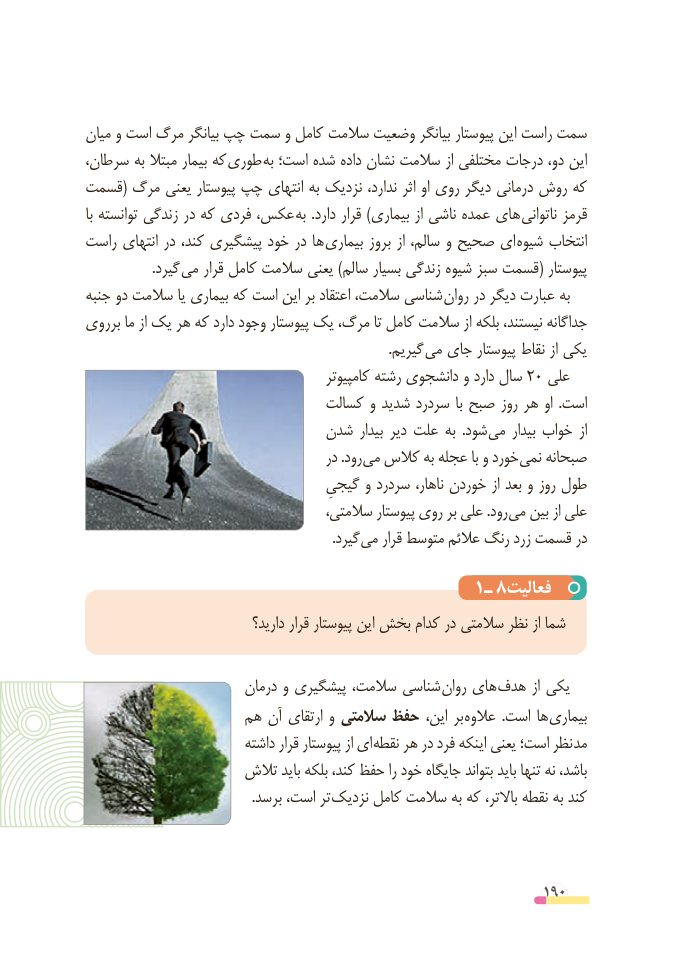

# PDF page 190

میان و است مرگ بیانگر چپ سمت و کامل سالمت وضعیت بیانگر پیوستار این راست سمت
سرطان، به مبتال بیمار که  طوری به است؛ شده داده نشان سالمت از مختلفی درجات دو، این
قسمت( مرگ یعنی پیوستار چپ انتهای به نزدیک ندارد، اثر او روی دیگر درمانی روش که
با توانسته زندگی در که فردی عکس، به  .دارد قرار )بیماری از ناشی عمده های  ناتوانی قرمز
راست انتهای در کند، پیشگیری خود در ها  بیماری بروز از سالم، و صحیح ای شیوه انتخاب
                    .گیرد می قرار کامل سالمت یعنی )سالم بسیار زندگی شیوه سبز قسمت( پیوستار
جنبه دو سالمت یا بیماری که است این بر اعتقاد سالمت، شناسی  روان در دیگر عبارت به
برروی ما از یک هر که دارد وجود پیوستار یک مرگ، تا کامل سالمت از بلکه نیستند، جداگانه
                                                                                         .گیریم می جای پیوستار نقاط از یکی
                                            کامپیوتر رشته دانشجوی و دارد سال 20 علی
                                کسالت و شدید سردرد  با صبح روز هر او  .است
                          شدن بیدار دیر علت به  .شود می بیدار خواب  از
                                         در .رود می کالس به عجله با و خورد نمی صبحانه
                                    گیجیِ و سردرد ناهار، خوردن از بعد و روز طول
                                    سالمتی، پیوستار روی بر علی .رود می بین از علی
               . گیرد می قرار متوسط عالئم رنگ زرد قسمت در

                                      1ـ 8فعالیت
                               دارید؟ قرار پیوستار این بخش کدام در سالمتی نظر از شما

                        درمان و پیشگیری سالمت، شناسی روان های هدف از یکی
                  هم آن ارتقای و سالمتی حفظ این، بر عالوه  .است ها بیماری
                          داشته قرار پیوستار از ای نقطه هر در فرد اینکه یعنی است؛ نظر مد
                   تالش باید بلکه کند، حفظ را خود جایگاه بتواند باید تنها نه باشد،
                                                 .برسد است، تر نزدیک کامل سالمت به که باالتر، نقطه به کند

                                                          190

