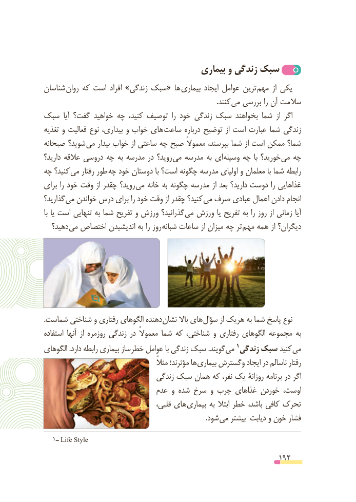

# PDF page 192

بیماری و زندگی سبک
شناسان  روان که است افراد »زندگی سبک« ها بیماری ایجاد عوامل ترین مهم  از یکی
                     . کنند می بررسی را آن سالمت
سبک  آیا گفت؟ خواهید چه کنید، توصیف  را خود زندگی سبک بخواهند شما  از اگر
تغذیه و فعالیت نوع بیداری، و خواب های ساعت درباره توضیح از است عبارت شما زندگی
صبحانه شوید؟  می بیدار خواب از ساعتی چه صبح معموالً بپرسند، شما از است ممکن شما؟
دارید؟ عالقه دروسی چه به مدرسه در روید؟  می مدرسه به ای وسیله چه  با خورید؟  می چه
چه کنید؟ می رفتار طور  چه خود دوستان با است؟ چگونه مدرسه اولیای و معلمان با شما رابطه
برای را خود وقت از چقدر روید؟  می خانه به چگونه مدرسه از بعد دارید؟ دوست را غذاهایی
گذارید؟  می خواندن درس برای را خود وقت از چقدر کنید؟  می صرف عبادی اعمال دادن انجام
با یا است تنهایی به شما تفریح و ورزش گذرانید؟  می ورزش یا تفریح به را روز از زمانی آیا
  دهید؟ می اختصاص اندیشیدن به را روز  شبانه ساعات از میزان چه تر  مهم همه از دیگران؟

.شماست شناختی و رفتاری الگوهای دهنده نشان باال های سؤال از هریک به شما پاسخ نوع
استفاده آنها  از روزمره زندگی در معموالً شما که شناختی، و رفتاری الگوهای مجموعه به
                                                            1الگوهای .دارد رابطه بیماری ساز خطر عوامل با زندگی سبک .گویند می زندگی سبک کنید می
                                                مثالً مؤثرند؛ ها بیماری وگسترش ایجاد در ناسالم رفتار
                                زندگی سبک همان که نفر، یک روزانۀ برنامه در اگر
                             عدم و شده سرخ و چرب غذاهای خوردن اوست،
                                      قلبی، های بیماری به ابتال خطر باشد، کافی تحرک
                     . شود می بیشتر دیابت و خون فشار

  1ــ Life Style

                                                          192

