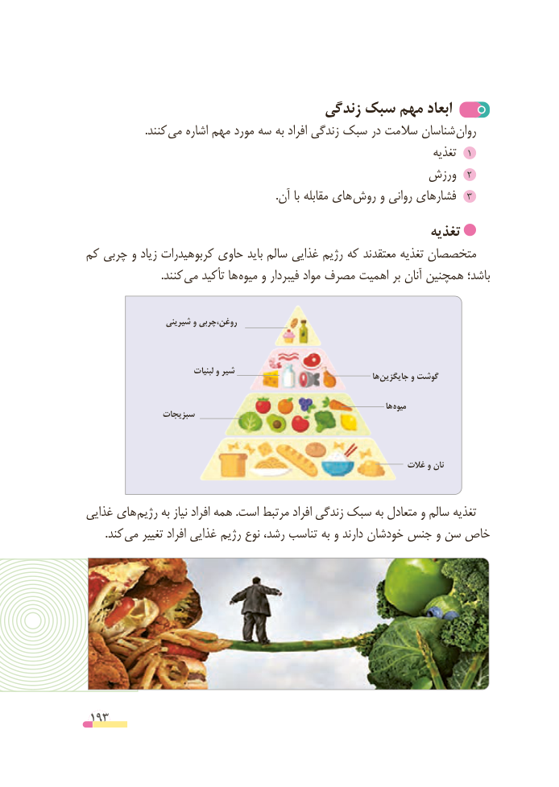

# PDF page 193

زندگی سبک مهم ابعاد
                     .کنند می اشاره مهم مورد سه به افراد زندگی سبک در سالمت شناسان روان
                                                                         تغذیه  1
                                                 ورزش  2
                                                                     .آن با مقابله های روش و روانی فشارهای  3
                                                         تغذیه
کم چربی و زیاد کربوهیدرات حاوی باید سالم غذایی رژیم که معتقدند تغذیه متخصصان
      . کنند می تأکید ها میوه و فیبردار مواد مصرف اهمیت بر آنان همچنین باشد؛

                   شیرینی و روغن،چربی

                                 لبنیات و شیر                                                                                    ها جایگزین و گوشت

                                                                                        ها میوه
                 سبزیجات

                                                                        غالت و نان

غذایی های رژیم به نیاز افراد همه .است مرتبط افراد زندگی سبک به متعادل و سالم تغذیه
  . کند می تغییر افراد غذایی رژیم نوع رشد، تناسب به و دارند خودشان جنس و سن خاص

 193

