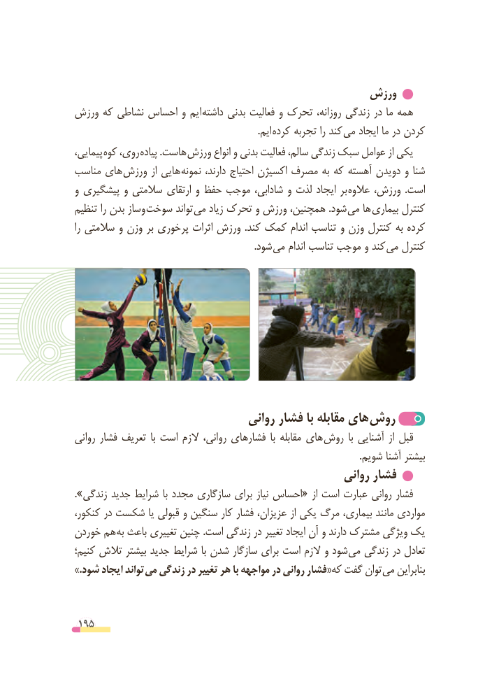

# PDF page 195

ورزش
ورزش که نشاطی احساس و ایم  داشته بدنی فعالیت و تحرک روزانه، زندگی در ما همه
                                                                             .ایم کرده تجربه را کند می ایجاد ما در کردن
پیمایی، کوه روی، پیاده .هاست  ورزش انواع و بدنی فعالیت سالم، زندگی سبک عوامل از یکی
مناسب های ورزش از هایی نمونه دارند، احتیاج اکسیژن مصرف به که آهسته دویدن و شنا
و پیشگیری و سالمتی ارتقای و حفظ موجب شادابی، و لذت ایجاد بر عالوه ورزش،  .است
تنظیم را بدن وساز  سوخت تواند می زیاد تحرک و ورزش همچنین، .شود می ها بیماری کنترل
را سالمتی و وزن بر پرخوری اثرات ورزش  .کند کمک اندام تناسب و وزن کنترل به کرده
                 . شود می اندام تناسب موجب و کند می کنترل

                                روانی فشار با مقابله های روش
روانی فشار تعریف  با است الزم روانی، فشارهای  با مقابله های روش  با آشنایی از قبل
                                                                                                                        .شویم آشنا بیشتر
                                                    روانی فشار
.»زندگی جدید شرایط با مجدد سازگاری برای نیاز احساس« از است عبارت روانی فشار
کنکور، در شکست یا قبولی و سنگین کار فشار عزیزان، از یکی مرگ بیماری، مانند مواردی
خوردن هم به باعث تغییری چنین .است زندگی در تغییر ایجاد آن و دارند مشترک ویژگی یک
کنیم؛ تالش بیشتر جدید شرایط با شدن سازگار برای است الزم و شود می زندگی در تعادل
.» شود ایجاد تواند می زندگی در تغییر هر با مواجهه در روانی فشار«که گفت توان می بنابراین

 195

