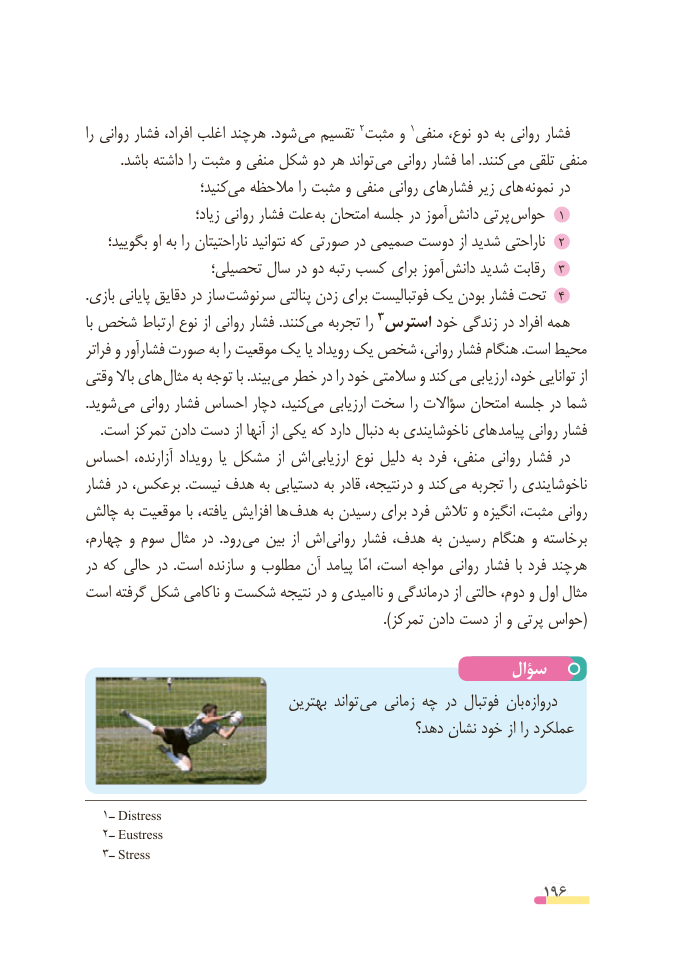

# PDF page 196

را روانی فشار افراد، اغلب هرچند  .شود می تقسیم 2مثبت و 1منفی نوع، دو به روانی فشار
. باشد داشته را مثبت و منفی شکل دو هر تواند می روانی فشار اما .کنند می تلقی منفی
                    کنید؛ می مالحظه را مثبت و منفی روانی فشارهای زیر های نمونه در
                       زیاد؛ روانی فشار علت  به امتحان جلسه در آموز دانش پرتی حواس  1
بگویید؛٢او به را ناراحتیتان نتوانید که صورتی در صمیمی دوست از شدید ناراحتی
                 تحصیلی؛ سال در دو رتبه کسب برای آموز دانش٣شدید رقابت
.بازی پایانی دقایق در ساز سرنوشت٤پنالتی زدن برای فوتبالیست یک بودن فشار تحت
با شخص ارتباط نوع از روانی فشار .کنند می تجربه را                                               3استرس خود زندگی در افراد همه
فراتر و فشارآور صورت به را موقعیت یک یا رویداد یک شخص روانی، فشار هنگام .است محیط
وقتی باال های مثال به توجه با .بیند می خطر در را خود سالمتی و کند می ارزیابی خود، توانایی از
.شوید می روانی فشار احساس دچار کنید، می ارزیابی سخت را سؤاالت امتحان جلسه در شما
. است تمرکز دادن دست از آنها از یکی که دارد دنبال به ناخوشایندی های پیامد روانی فشار
احساس آزارنده، رویداد یا مشکل از اش ارزیابی نوع دلیل به فرد منفی، روانی فشار در
فشار در برعکس، .نیست هدف به دستیابی به قادر نتیجه،  در و کند می تجربه را ناخوشایندی
چالش به موقعیت با یافته، افزایش ها هدف به رسیدن برای فرد تالش و انگیزه مثبت، روانی
چهارم، و سوم مثال در  .رود  می بین از اش  روانی فشار هدف، به رسیدن هنگام و برخاسته
در که حالی در  .است سازنده و مطلوب آن پیامد  امّا است، مواجه روانی فشار با فرد هرچند
است گرفته شکل ناکامی و شکست نتیجه در و امیدی  نا و درماندگی از حالتی دوم، و اول مثال
                                                                           ).تمرکز دادن دست از و پرتی حواس(

                                                سؤال
                                بهترین تواند  می زمانی چه در فوتبال بان دروازه
                                               دهد؟ نشان خود از را عملکرد

  1ــ Distress
  2ــ Eustress
  3ــ Stress

                                                          196

