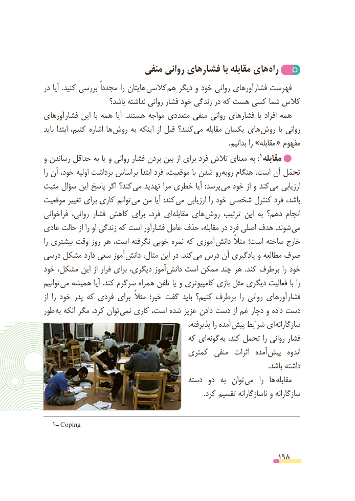

# PDF page 198

منفی روانی فشارهای با مقابله های  راه
در آیا  .کنید بررسی مجدداً را هایتان کالسی هم دیگر و خود روانی آورهای  فشار فهرست
                     باشد؟ نداشته روانی فشار خود زندگی در که هست کسی شما کالس
آورهای  فشار این  با همه  آیا  .هستند مواجه متعددی منفی روانی فشارهای  با افراد همه
باید ابتدا کنیم، اشاره ها  روش به اینکه از قبل کنند؟ می مقابله یکسان های روش  با روانی
           . «بدانیم را »مقابله  مفهوم
                                                                      1و رساندن حداقل به یا و روانی فشار بردن بین از برای فرد تالش معنای به : مقابله
را آن خود، اولیه برداشت اساس  بر ابتدا فرد موقعیت، با شدن رو روبه هنگام است، آن تحمّل
مثبت سؤال این پاسخ اگر کند؟  می تهدید مرا خطری آیا  :پرسد  می خود از و کند می ارزیابی
موقعیت تغییر برای کاری توانم می من آیا :کند می ارزیابی را خود شخصی کنترل فرد باشد،
فراخوانی روانی، فشار کاهش برای فرد، ای مقابله های روش ترتیب این به دهم؟ انجام
عادی حالت از را او زندگی که است فشارآور عامل حذف مقابله، در فرد اصلی هدف .شوند می
را بیشتری وقت روز هر است، نگرفته خوبی نمره که آموزی  دانش مثالً است؛ ساخته خارج
درسی مشکل دارد سعی آموز  دانش مثال، این در .کند  می درس آن یادگیری و مطالعه صرف
خود مشکل، این از فرار برای دیگری، آموز دانش است ممکن چند هر  .کند برطرف را خود
توانیم می همیشه آیا .کند سرگرم همراه تلفن یا و کامپیوتری بازی مثل دیگری فعالیت با را
از  را خود پدر که فردی برای  مثالً خیر؛ گفت باید کنیم؟ برطرف  را روانی آورهای فشار
طور به آنکه مگر کرد، توان نمی کاری است، شده عزیز دادن دست از غم دچار و داده دست
                                                   پذیرفته، را آمده پیش شرایط ای سازگارانه
                                      که ای گونه به کند، تحمل را روانی فشار
                                    کمتری  منفی  اثرات  آمده پیش  اندوه
                                                                                                                                 .باشد داشته
                                        دسته  دو  به  توان  می   را  ها  مقابله
                                                                                            .کرد تقسیم ناسازگارانه و سازگارانه

  1ــ Coping

                                                          198

