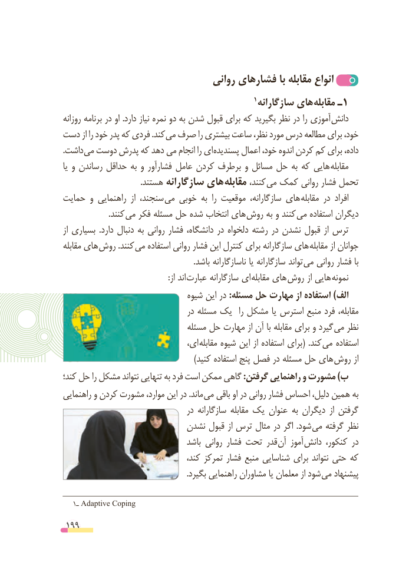

# PDF page 199

روانی فشارهای با مقابله انواع
                                                      1 سازگارانه های مقابله ـ1
روزانه برنامه در او .دارد نیاز نمره دو به شدن قبول برای که بگیرید نظر در را آموزی دانش
دست از را خود پدر که فردی .کند می صرف را بیشتری ساعت نظر، مورد درس مطالعه برای خود،
.داشت می دوست پدرش که دهد می انجام را ای پسندیده اعمال خود، اندوه کردن کم برای داده،
یا و رساندن حداقل به و فشارآور عامل کردن برطرف و مسائل حل به که هایی مقابله
  . هستند سازگارانه های مقابله کنند، می کمک روانی فشار تحمل
حمایت و راهنمایی  از سنجند،  می خوبی به  را موقعیت سازگارانه، های مقابله در  افراد
     . کنند می فکر مسئله حل شده انتخاب های روش به و کنند می استفاده دیگران
از بسیاری  .دارد دنبال به روانی فشار دانشگاه، در دلخواه رشته در نشدن قبول از ترس
مقابله های روش .کنند می استفاده روانی فشار این کنترل برای سازگارانه های  مقابله از جوانان
                                                                 .باشد ناسازگارانه یا سازگارانه تواند  می روانی فشار با
          : از اند عبارت سازگارانه ای  مقابله های روش از هایی نمونه
                                شیوه این در :مسئله حل مهارت از استفاده )الف
                                   در مسئله یک   را مشکل یا استرس منبع فرد مقابله،
                                مسئله حل مهارت از آن با مقابله برای و گیرد می نظر
                                 ای، مقابله شیوه این از استفاده برای(  .کند می استفاده
  ) کنید استفاده پنج فصل در مسئله حل های روش از
کند؛ حل را مشکل نتواند تنهایی به فرد است ممکن گاهی :گرفتن راهنمایی و مشورت )ب
راهنمایی و کردن مشورت موارد، این در .ماند می باقی او در روانی فشار احساس دلیل، همین به
                                   در سازگارانه مقابله یک عنوان به دیگران  از گرفتن
                          نشدن قبول از ترس مثال در اگر  .شود می گرفته نظر
                                   باشد روانی فشار تحت قدر آن آموز دانش کنکور، در
                                    کند، تمرکز فشار منبع شناسایی برای نتواند حتی که
                                                              .بگیرد راهنمایی مشاوران یا معلمان از شود می پیشنهاد

   1ـ Adaptive Coping

 199

