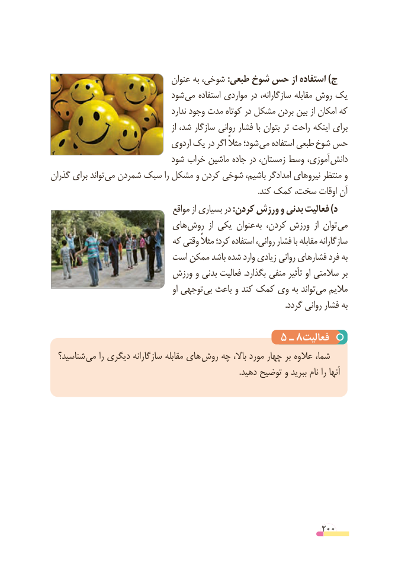

# PDF page 200

عنوان به شوخی، :طبعی شوخ حس از استفاده )ج
                            شود می استفاده مواردی در سازگارانه، مقابله روش یک
                                        ندارد وجود مدت کوتاه در مشکل بردن بین از امکان که
                                                 از شد، سازگار روانی فشار با بتوان تر راحت اینکه برای
                               اردوی یک در اگر مثالً شود؛ می استفاده طبعی شوخ حس
                            شود خراب ماشین جاده در زمستان، وسط آموزی، دانش
گذران برای تواند می شمردن سبک را مشکل و کردن شوخی باشیم، امدادگر نیروهای منتظر و
                                                                                                       .کند کمک سخت، اوقات آن
                                   مواقع از بسیاری در :کردن ورزش و بدنی فعالیت )د
                         های روش  از یکی عنوان به کردن، ورزش  از توان می
                            که وقتی مثالً کرد؛ استفاده روانی، فشار با مقابله سازگارانه
                        است ممکن باشد شده وارد زیادی روانی فشارهای فرد به
                        ورزش و بدنی فعالیت .بگذارد منفی تأثیر او سالمتی بر
                                              او توجهی بی باعث و کند کمک وی به تواند می مالیم
                                                                                                                    .گردد روانی فشار به

                                     5 ـ 8فعالیت
  شناسید؟ می را دیگری سازگارانه مقابله های  روش چه باال، مورد چهار بر عالوه شما،
                                                                                              .دهید توضیح و ببرید نام را آنها

                                                          200

