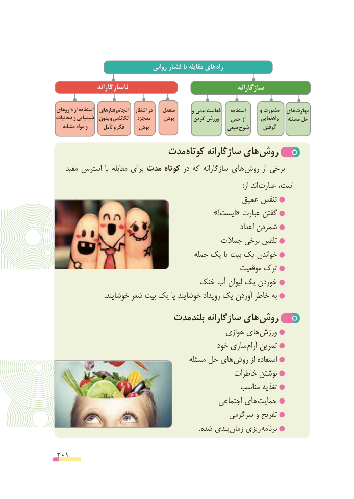

# PDF page 201

روانی فشار با مقابله های راه
               ناسازگارانه                                     سازگارانه

داروهای از استفاده   رفتارهای انجام    انتظار در    منفعل       و بدنی فعالیت    استفاده      و مشورت  های مهارت
دخانیات و شیمیایی  بدون و تکانشی   معجزه     بودن       کردن ورزش  حس از       راهنمایی    مسئله حل
   مشابه مواد و       تأمل و فکر      بودن                            طبعی شوخ     گرفتن

                   مدت کوتاه سازگارانه های روش
   مفید استرس  با مقابله برای مدت کوتاه در که سازگارانه های روش از برخی
                     : از اند عبارت است،
                                              عمیق تنفس
                                                    »!ایست« عبارت گفتن
                                                                   اعداد شمردن
                                       جمالت برخی تلقین
                                       جمله یک یا بیت یک خواندن
                                                   موقعیت ترک
                            خنک آب لیوان یک خوردن
                            .خوشایند شعر بیت یک یا خوشایند رویداد یک آوردن خاطر به
                    مدت بلند سازگارانه های روش
                                              هوازی های ورزش
                                            خود سازی آرام تمرین
                                        مسئله حل های روش از استفاده
                                                خاطرات نوشتن
                                                مناسب تغذیه
                                                اجتماعی های حمایت
                                           سرگرمی و تفریح
                                                                                  .شده بندی زمان ریزی برنامه

201

