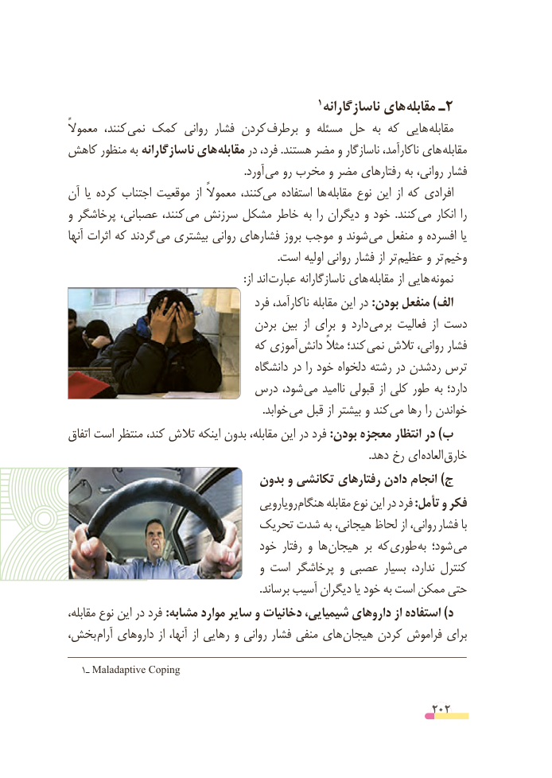

# PDF page 202

1 ناسازگارانه های مقابله ـ2
ًکنند،معموال         نمی کمک روانی فشار کردن  برطرف و مسئله حل  به که هایی  مقابله
کاهش منظور به ناسازگارانه های مقابله در فرد، .هستند مضر و ناسازگار ناکارآمد، های مقابله
               . آورد می رو مخرب و مضر رفتارهای به روانی، فشار
آن یا کرده اجتناب موقعیت از معموالً کنند،می    استفاده ها مقابله نوع این از که افرادی
و پرخاشگر عصبانی، کنند، می سرزنش مشکل خاطر به را دیگران و خود  .کنند می انکار را
آنها اثرات که گردند می بیشتری روانی فشارهای بروز موجب و شوند  می منفعل و افسرده یا
                                                                             .است اولیه روانی فشار از تر  عظیم و تر وخیم
             : از اند عبارت ناسازگارانه های مقابله از هایی نمونه
                                      فرد ناکارآمد، مقابله این در :بودن منفعل )الف
                                   بردن بین  از برای و دارد می بر فعالیت  از دست
                                که آموزی  دانش مثالً کند؛  نمی تالش روانی، فشار
                                       دانشگاه در را خود دلخواه رشته در ردشدن ترس
                        درس شود، می ناامید قبولی از کلی طور به دارد؛
             . خوابد می قبل از بیشتر و کند می رها را خواندن
اتفاق است منتظر کند، تالش اینکه بدون مقابله، این در فرد :بودن معجزه انتظار در )ب
           . دهد رخ ای العاده خارق
                               بدون و تکانشی رفتارهای دادن انجام )ج
                                        رویارویی هنگام مقابله نوع این در فرد :تأمل و فکر
                            تحریک شدت به هیجانی، لحاظ از روانی، فشار با
                                  خود رفتار و ها هیجان بر که طوری به شود؛ می
                                      و است پرخاشگر و عصبی بسیار ندارد، کنترل
                                                                       .برساند آسیب دیگران یا خود به است ممکن حتی
مقابله، نوع این در فرد :مشابه موارد سایر و دخانیات شیمیایی، داروهای از استفاده )د
بخش، آرام داروهای از آنها، از رهایی و روانی فشار منفی های هیجان کردن فراموش برای

   1ـ Maladaptive Coping

                                                          202

