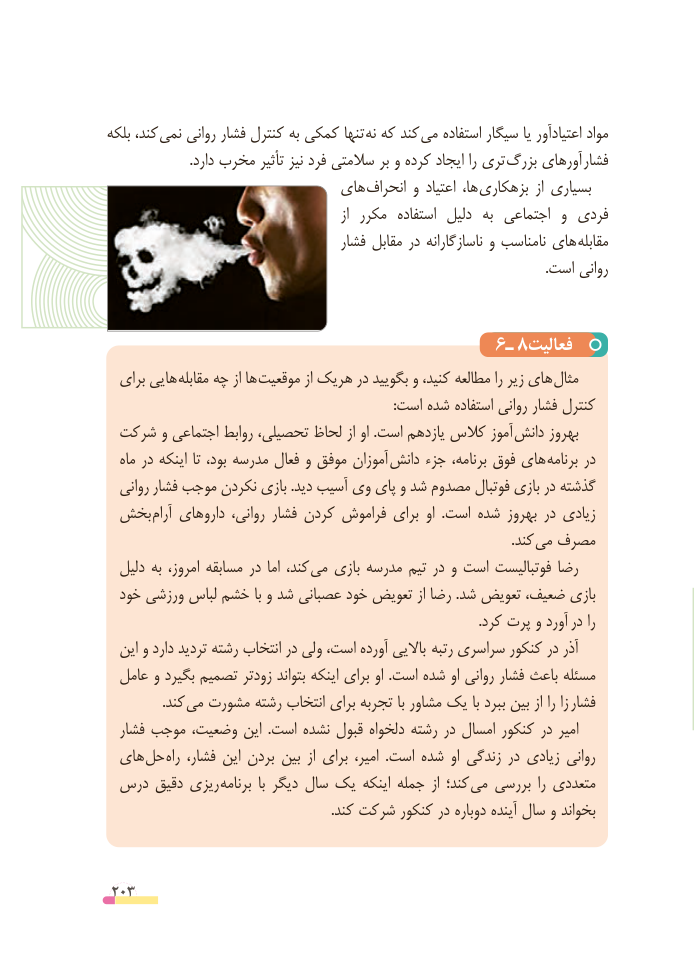

# PDF page 203

بلکه کند، نمی روانی فشار کنترل به کمکی تنها نه که کند می استفاده سیگار یا اعتیادآور مواد
                        .دارد مخرب تأثیر نیز فرد سالمتی بر و کرده ایجاد را تری  بزرگ آورهای فشار
                            های  انحراف و اعتیاد ها، بزهکاری  از بسیاری
                                                       از  مکرر  استفاده  دلیل  به  اجتماعی  و فردی
                                     فشار مقابل در ناسازگارانه و نامناسب های مقابله
                                                                                                                                 .است روانی

                                      6ـ 8فعالیت
  برای هایی مقابله چه از ها موقعیت از هریک در بگویید و کنید، مطالعه را زیر های مثال
                                                                                    :است شده استفاده روانی فشار کنترل
 شرکت و اجتماعی روابط تحصیلی، لحاظ از او .است یازدهم کالس آموز دانش بهروز
  ماه در اینکه تا بود، مدرسه فعال و موفق آموزان  دانش جزء برنامه، فوق های  برنامه در
  روانی  فشار موجب نکردن بازی .دید آسیب وی پای و شد مصدوم فوتبال بازی در گذشته
 بخش آرام داروهای روانی، فشار کردن فراموش برای او  .است شده بهروز در زیادی
                             . کند می مصرف
  دلیل به امروز، مسابقه در اما کند، می بازی مدرسه تیم در و است فوتبالیست رضا
  خود ورزشی لباس خشم با و شد عصبانی خود تعویض از رضا .شد تعویض ضعیف، بازی
        . کرد پرت و آورد در را
  این و دارد تردید رشته انتخاب در ولی است، آورده باالیی  رتبه سراسری کنکور در آذر
  عامل و بگیرد تصمیم زودتر بتواند اینکه برای او .است شده او روانی فشار باعث مسئله
    . کند می مشورت رشته انتخاب برای تجربه با مشاور یک با ببرد بین از را زا فشار
  فشار موجب وضعیت، این  .است نشده قبول دلخواه رشته در امسال کنکور در امیر
  های حل راه فشار، این بردن بین  از برای امیر،  .است شده او زندگی در زیادی روانی
 درس دقیق ریزی  برنامه  با دیگر سال یک اینکه جمله  از کند؛  می بررسی  را متعددی
                                                                  .کند شرکت کنکور در دوباره آینده سال و بخواند

 203

