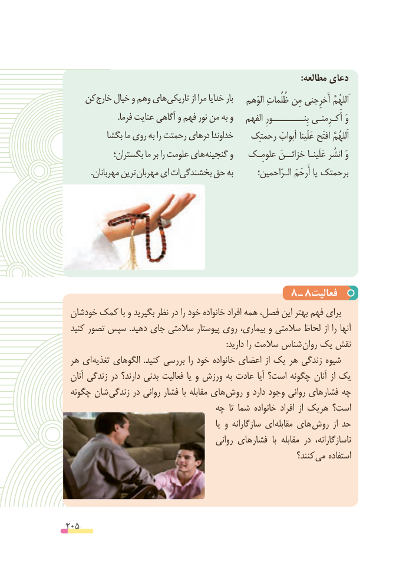

# PDF page 205

:مطالعه دعای
    کن خارج خیال و وهم های تاریکی از مرا خدایا بار    الوَهم ظُلُماتِ مِن أَخرِجنی  َاللهُمَّ
                          .فرما عنایت آگاهی و فهم نور من به و    الفهم بِنـــــــــورِ أَکـرِمنـی وَ
          بگشا ما روی به را رحمتت درهای خداوندا    رحمتِک أبوابَ عَلَینا افتَح  اَللهُمَّ
             بگستران؛ ما بر را علومت های گنجینه و    علومِـک خزائــنَ عَلَینـا انشُر وَ
 . مهربانان ترین مهربان ای ات بخشندگی حق به        الـرّاحمین؛ أَرحَمَ یا برحمتک

                                                    8 ـ 8فعالیت
 خودشان کمک با و بگیرید نظر در را خود خانواده افراد همه فصل، این بهتر فهم برای
 کنید تصور سپس  .دهید جای سالمتی پیوستار روی بیماری، و سالمتی لحاظ از را آنها
    : دارید را سالمت شناس روان یک نقش
 هر ای تغذیه الگوهای  .کنید بررسی را خود خانواده اعضای از یک هر زندگی شیوه
 آنان زندگی در دارند؟ بدنی فعالیت یا و ورزش به عادت آیا است؟ چگونه آنان از یک
 چگونه شان  زندگی در روانی فشار با مقابله های  روش و دارد وجود روانی های  فشار چه
                                چه  تا شما خانواده افراد  از هریک است؟
                                                             یا و سازگارانه ای مقابله های روش  از حد
                                           روانی های  فشار  با مقابله در  ناسازگارانه،
                                                                 کنند؟ می استفاده

205

