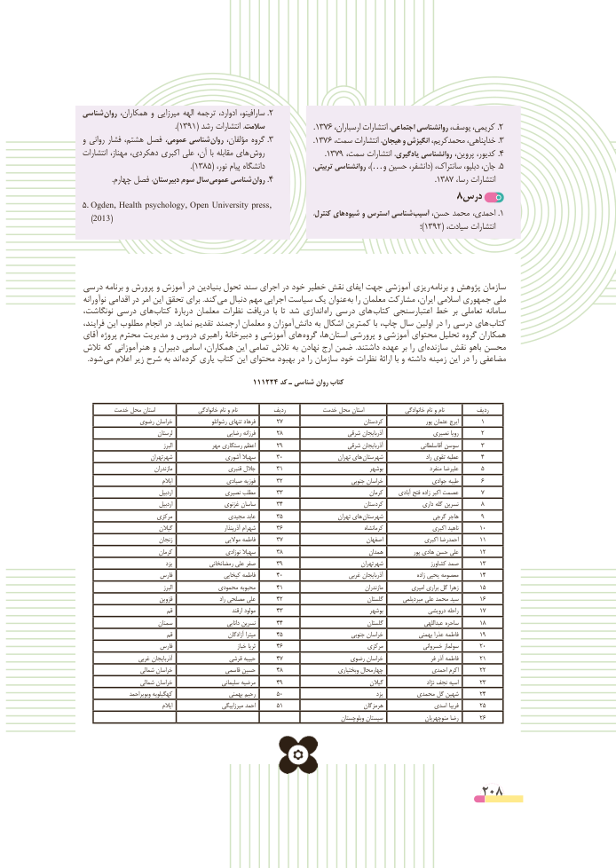

# PDF page 208

شناسی روان همکاران، و میرزایی الهه ترجمه ادوارد، سارافینو، .2
                           .)1391( رشد انتشارات سالمت،                          .١٣٧٦ ،کریمی،ارسباران انتشارات اجتماعی، روانشناسی یوسف،        .2
و روانی فشار هشتم، فصل عمومی، شناسی روان مؤلفان، گروه .3                      . ١٣٧٦ ،خداپناهی،سمت انتشارات هیجان، و انگیزش محمدکریم،           .3
انتشارات مهناز، دهکردی، اکبری علی آن، با مقابله های  روش                                 .١٣٧٩ ،کدیور،سمت انتشارات یادگیری، روانشناسی پروین،        .4
                                ).1385( ،دانشگاهنور پیام  ،جان،تربیتی روانشناسی ،…)و حسین دانشفر،( سانتراک، دبلیو،      .5
 . چهارم فصل دبیرستان، سوم سال عمومی شناسی روان .4                                                                                         .١٣٨٧ ،انتشاراترسا
                                                                 8درس
5. Ogden, Health psychology, Open University press,                            ،هایکنترل        شیوه و استرس شناسی آسیب حسن، محمد احمدی، .1  (2013)                                                                                                                                                                      ؛)1392( ،انتشاراتسیادت

درسی برنامه و پرورش و آموزش در بنیادین تحول سند اجرای در خود خطیر نقش ایفای جهت آموزشی ریزی  برنامه و پژوهش سازمان
نوآورانه اقدامی در امر این تحقق برای .کند  می دنبال مهم اجرایی سیاست یک عنوان به را معلمان مشارکت ایران، اسالمی جمهوری ملی
نونگاشت، درسی های کتاب دربارۀ معلمان نظرات دریافت  با  تا شد اندازی راه درسی های کتاب اعتبارسنجی خط بر تعاملی سامانه
فرایند، این مطلوب انجام در .نماید تقدیم ارجمند معلمان و آموزان  دانش به اشکال کمترین با چاپ، سال اولین در را درسی های  کتاب
آقای پروژه محترم مدیریت و دروس راهبری دبیرخانۀ و آموزشی های گروه ها، استان پرورشی و آموزشی محتوای تحلیل گروه همکاران
تالش که هنرآموزانی و دبیران اسامی همکاران، این تمامی تالش به نهادن ارج ضمن  .داشتند عهده بر را ای  سازنده نقش باهو محسن
 . شود می اعالم زیر شرح به اند کرده یاری کتاب این محتوای بهبود در را سازمان خود نظرات ارائۀ با و داشته زمینه این در را مضاعفی

                                        111224 کد ـ شناسی روان کتاب

         خدمت محل استان                 خانوادگی نام و نام            ردیف          خدمت محل استان                خانوادگی نام و نام           ردیف
                رضوی خراسان                  رشوانلو تنهای فرهاد       27                             کردستان                    پور عثمان ایرج       1
                              لرستان                  رضایی فرزانه       28                    شرقي آذربايجان                نصیری رویا       2
                                             البرز              مهر رستگاری اعظم       29                    شرقي آذربايجان                آقاسلطانی سوسن       3
                         شهرتهران                 آشوري سهيال       30                      تهران های شهرستان                      راد تقوی عطیه       4
                                مازندران                     قنبری جالل       31                                بوشهر                    منفرد علیرضا       5
                                      ايالم                 صیادی فوزیه       32                         جنوبي خراسان                 جوادی طیبه       6
                                  اردبيل                 نصیری مطلب       33                               کرمان      آبادی فتح زاده اکبر عصمت       7
                                  اردبيل                  غزنوی ساسان       34                             کردستان              داری گله نسرین       8
                        مرکزي                 مجیدی عابد       35                      تهران های شهرستان               گرجی هاجر       9
                            گيالن                          آذرپنذار شهرام       36                                  کرمانشاه                  اکبری ناهید       10
                            زنجان                    موالیی فاطمه       37                              اصفهان               اکبری احمدرضا       11
                            کرمان                     نوزادی سهیال       38                             همدان              پور هادی حسن علی       12
                                    يزد              رمضانخانی علی صفر       39                            شهرتهران                  كشاورز صمد       13
                         فارس                  کیخایی فاطمه       40                       غربي آذربايجان                 زاده یحیی معصومه       14
                                             البرز              محمودی محبوبه       41                                    مازندران           امیری براری گل زهرا       15
                             قزوين                        راد مصلحی علی       42                               گلستان        میردیلمی علی محمد سید       16
                              قم                             ارقند مولود       43                                بوشهر               درویشی راحله       17
                          سمنان                         دانایی نسرین       44                               گلستان                 عبداللهی ساحره       18
                              قم                        آزادگان میترا       45                         جنوبي خراسان             بهمنی عذرا فاطمه       19
                         فارس                             خباز ثریا       46                           مرکزي              خسروانی سولماز       20
                   غربي آذربايجان                  قرشی حبیبه       47                  رضوی خراسان                    فر آذر فاطمه       21
                     شمالي خراسان                  قاسمی حسین       48                     وبختياري چهارمحال                احمدی اکرم       22
                     شمالي خراسان                    سلیمانی مرضیه       49                                گيالن                       نژاد نجف اسیه       23
                    وبويراحمد کهگيلويه                    بهمنی رحیم       50                                         يزد          محمدی گل شهین       24
                                      ايالم                     میرزابیگی احمد       51                             هرمزگان                اسدی فریبا       25
                                                                                                     وبلوچستان سيستان                منوچهریان رضا       26

                                                         208

