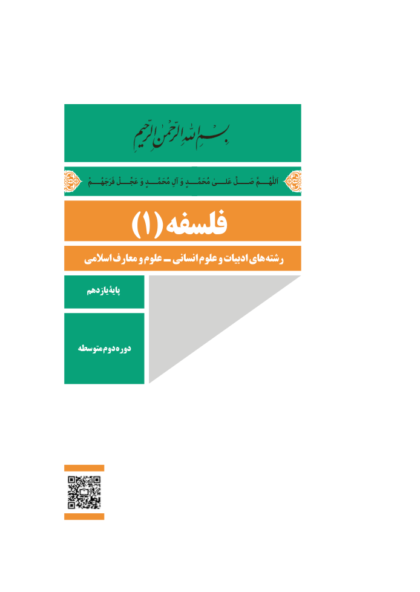

# PDF page 1

فَرَجَهُــــمْاَللّٰهُــــمَّعَجِّــــلْ وَ مُحَمَّــــدٍ آلِ وَ مُحَمَّــــدٍ عَلــــیٰ صَـــــلِّ
     )1(       فلسفه
 اسالمی معارف و علوم  ـ  انسانی علوم و ادبیات های رشته

  یازدهمپایۀ

متوسطه دوم دوره

