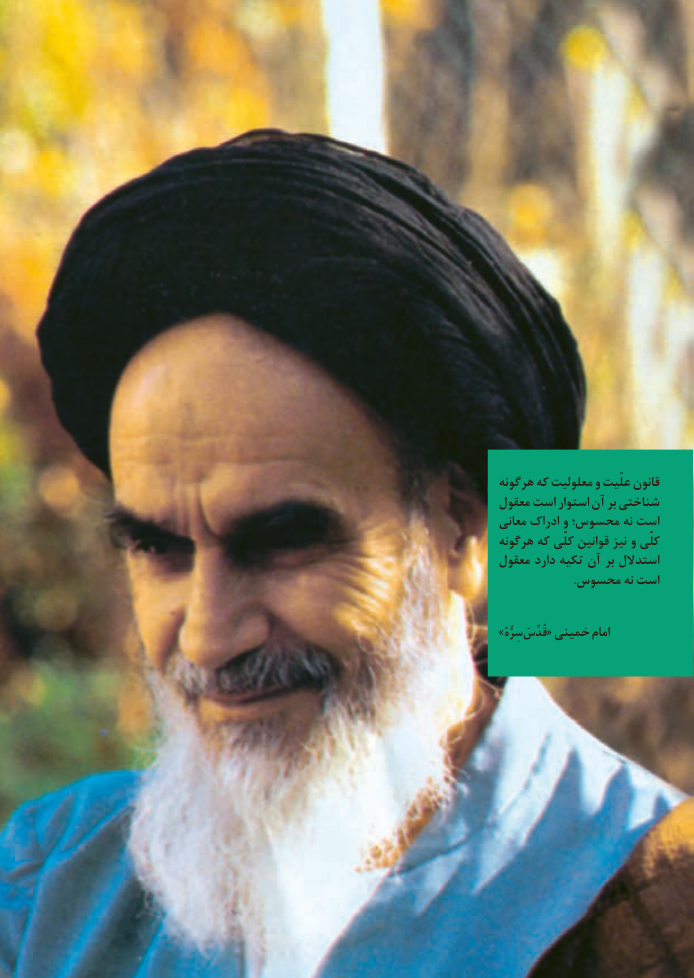

# PDF page 3

هرگونه که معلولیت و علّیت قانون
معقول است استوار آن بر شناختی
معانی ادراک و محسوس؛ نه است
هرگونه که کلّی قوانین نیز و کلّی
معقول دارد تکیه آن بر استدالل
                         .محسوس نه است

»سِرُّهُ قُدِّسَامام« خمینی

