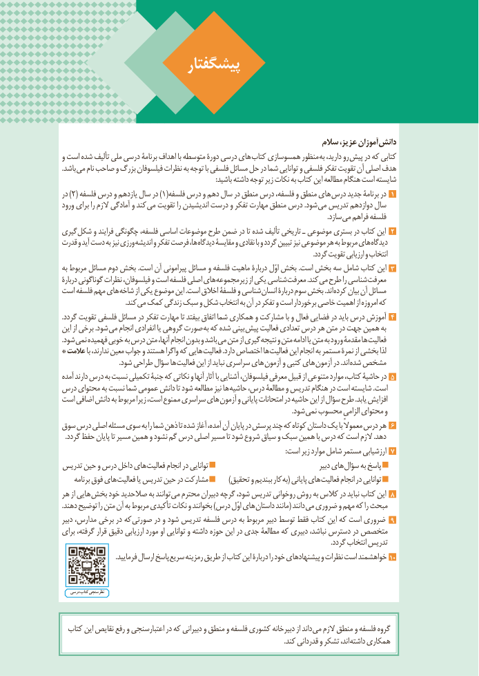

# PDF page 6

پیشگفتار

                                                              سالم عزیز، آموزان دانش
و است شده تألیف ملی درسی برنامۀ اهداف با متوسطه دورۀ درسی های کتاب همسوسازی منظور به دارید، رو پیش در که کتابی
.باشد می نام صاحب و بزرگ فیلسوفان نظرات به توجه با فلسفی مسائل حل در شما توانایی و فلسفی تفکر تقویت آن اصلی هدف
                                                                                        :باشید داشته توجه زیر نکات به کتاب این مطالعه هنگام است شایسته
در ) ٢( فلسفه درس و یازدهم سال در ) ١(فلسفه درس و دهم سال در منطق درس فلسفه، و منطق های درس جدید برنامۀ در 1
ورود برای را الزم آمادگی و کند می تقویت را اندیشیدن درست و تفکر مهارت منطق درس .شود می تدریس دوازدهم سال
                                                                                                                                                         .سازد می فراهم فلسفه
گیری شکل و فرایند چگونگی فلسفه، اساسی موضوعات طرح ضمن در تا شده تألیف تاریخی ـ موضوعی بستری در کتاب این 2
قدرت و آید دست به نیز ورزی اندیشه و تفکر فرصت ها، دیدگاه مقایسۀ و نقادی با و گردد تبیین نیز موضوعی هر به مربوط های دیدگاه
                                                                                                                                                      .گردد تقویت ارزیابی و انتخاب
به مربوط مسائل دوم بخش .است آن پیرامونی مسائل و فلسفه ماهیت دربارۀ اوّل بخش .است بخش سه شامل کتاب این 3
دربارۀ گوناگونی نظرات فیلسوفان، و است فلسفه اصلی های زیرمجموعه از یکی شناسی معرفت .کند می طرح را شناسی معرفت
است فلسفه مهم های شاخه از یکی موضوع این .است اخالق فلسفۀ و شناسی انسان دربارۀ سوم بخش .اند کرده بیان آن مسائل
                                     .کند می کمک زندگی سبک و شکل انتخاب به آن در تفکر و است برخوردار خاصی اهمیت از امروزه که
.گردد تقویت فلسفی مسائل در تفکر مهارت تا بیفتد اتفاق شما همکاری و مشارکت با و فعال فضایی در باید درس آموزش 4
این از برخی .شود می انجام انفرادی یا گروهی صورت به که شده بینی پیش فعالیت تعدادی درس هر متن در جهت همین به
.شود نمی فهمیده خوبی به درس متن آنها، انجام بدون و باشد می متن از گیری نتیجه و متن ادامه یا متن به ورود مقدمۀ ها فعالیت
* عالمت با ندارند، معین جواب و هستند واگرا که هایی فعالیت .دارد اختصاص ها فعالیت این انجام به مستمر نمرۀ از بخشی لذا
  . شود طراحی سؤال ها فعالیت این از نباید سراسری های آزمون و کتبی های آزمون در .اند شده مشخص
آمده دارند درس به نسبت تکمیلی جنبۀ که نکاتی و آنها آثار با آشنایی فیلسوفان، معرفی قبیل از متنوعی موارد کتاب، حاشیۀ در 5
درس محتوای به نسبت شما عمومی دانش تا شود مطالعه نیز ها حاشیه درس، مطالعۀ و تدریس هنگام در است شایسته .است
است اضافی دانش به مربوط زیرا است، ممنوع سراسری های آزمون و پایانی امتحانات در حاشیه این از سؤال طرح .یابد افزایش
                                                                                                                                    .شود نمی محسوب الزامی محتوای و
سوق درس اصلی مسئله سوی به را شما ذهن تا شده آغاز آمده، آن پایان در پرسش چند که کوتاه داستان یک با معموالً درس هر 6
  .گردد حفظ پایان تا مسیر همین و نشود گم درس اصلی مسیر تا شود شروع سیاق و سبک همین با درس که است الزم .دهد
                                                                                                                                :است زیر موارد شامل مستمر ارزشیابی 7
تدریس حین و درس داخل های فعالیت انجام در توانایی                                         دبیر های سؤال به پاسخ
     برنامه فوق های فعالیت یا تدریس حین در مشارکت         )تحقیق و ببندیم کار به( پایانی های فعالیت انجام در توانایی
هر از هایی بخش خود صالحدید به توانند می محترم دبیران گرچه شود، تدریس روخوانی روش به کالس در نباید کتاب این 8
.دهند توضیح را متن آن به مربوط تأکیدی نکات و بخوانند )درس اوّل های داستان مانند( دانند می ضروری و مهم که را مبحث
دبیر مدارس، برخی در که صورتی در و شود تدریس فلسفه درس به مربوط دبیر توسط فقط کتاب این که است ضروری 9
برای گرفته، قرار دقیق ارزیابی مورد او توانایی و داشته حوزه این در جدی مطالعۀ که دبیری نباشد، دسترس در متخصص
                                                                                                                                                           .گردد انتخاب تدریس
  . فرمایید ارسال پاسخ سریع رمزینه طریق از کتاب این دربارۀ را خود پیشنهادهای و نظرات است خواهشمند 10

    درسی کتاب نظرسنجی

  کتاب این نقایص رفع و اعتبارسنجی در که دبیرانی و منطق و فلسفه کشوری دبیرخانه از داند می الزم منطق و فلسفه گروه
                                                                                                                                .کند قدردانی و تشکر اند، داشته همکاری

