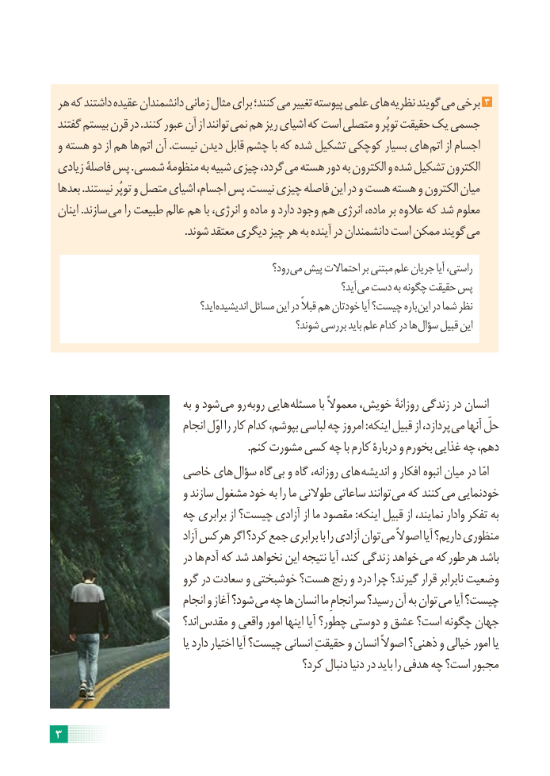

# PDF page 9

هر که داشتند عقیده دانشمندان زمانی مثال برای کنند؛ می تغییر پیوسته علمی های نظریه گویند می برخی 3
گفتند بیستم قرن در .کنند عبور آن از توانند نمی هم ریز اشیای که است متصلی و توپُر حقیقت یک جسمی
و هسته دو از هم ها اتم آن .نیست دیدن قابل چشم با که شده تشکیل کوچکی بسیار های اتم از اجسام
زیادی فاصلۀ پس .شمسی منظومۀ به شبیه چیزی گردد، می هسته دور به الکترون و شده تشکیل الکترون
بعدها .نیستند توپُر و متصل اشیای اجسام، پس .نیست چیزی فاصله این در و هست هسته و الکترون میان
اینان .سازند می را طبیعت عالم هم با انرژی، و ماده و دارد وجود هم انرژی ماده، بر عالوه که شد معلوم
 . شوند معتقد دیگری چیز هر به آینده در دانشمندان است ممکن گویند می

                                                   رود؟ می پیش احتماالت بر مبتنی علم جریان آیا راستی،
                                                                          آید؟ می دست به چگونه حقیقت پس
                                        اید؟ اندیشیده مسائل این در قبالً هم خودتان آیا چیست؟ باره این در شما نظر
                                                    شوند؟ بررسی باید علم کدام در ها سؤال قبیل این

                             به و شود می رو روبه هایی مسئله با معموالً خویش، روزانۀ زندگی در انسان
                            انجام اوّل را کار کدام بپوشم، لباسی چه امروز :اینکه قبیل از پردازد، می آنها حلّ
                                                                       .کنم مشورت کسی چه با کارم دربارۀ و بخورم غذایی چه دهم،
                  خاصی های سؤال گاه بی و گاه روزانه، های اندیشه و افکار انبوه میان در امّا
                          و سازند مشغول خود به را ما طوالنی ساعاتی توانند می که کنند می خودنمایی
                    چه برابری از چیست؟ آزادی از ما مقصود :اینکه قبیل از نمایند، وادار تفکر به
                                   آزاد هرکس اگر کرد؟ جمع برابری با را آزادی توان می اصوالً آیا داریم؟ منظوری
                           در ها آدم که شد نخواهد این نتیجه آیا کند، زندگی خواهد می که طور هر باشد
                        گرو در سعادت و خوشبختی هست؟ رنج و درد چرا گیرند؟ قرار نابرابر وضعیت
                            انجام و آغاز شود؟ می چه ها انسان ما سرانجامِ رسید؟ آن به توان می آیا چیست؟
                                اند؟ مقدس و واقعی امور اینها آیا چطور؟ دوستی و عشق است؟ چگونه جهان
                                      یا دارد اختیار آیا چیست؟ انسانی حقیقتِ و انسان اصوالً ذهنی؟ و خیالی امور یا
                                               کرد؟ دنبال دنیا در باید را هدفی چه است؟ مجبور

3

