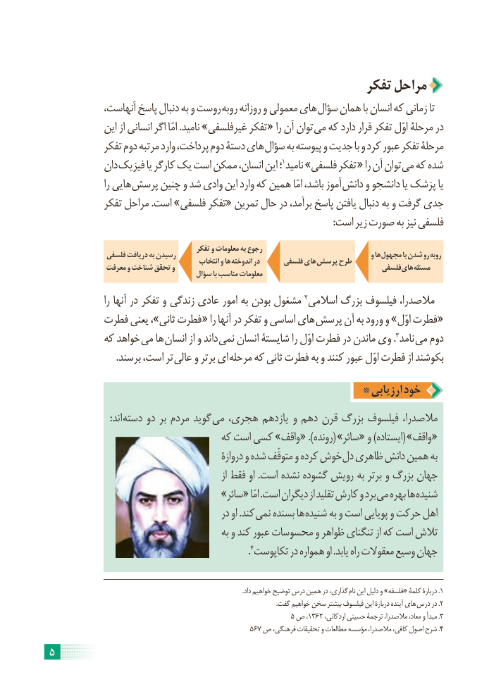

# PDF page 11

تفکر مراحل
  ،روستآنهاست پاسخ دنبال به و         روبه روزانه و معمولی های سؤال همان با انسان که زمانی تا
             این از انسانی اگر امّا .نامید »غیرفلسفی تفکر « را آن توان می که دارد قرار تفکر اوّل مرحلۀ در
            تفکر دوم مرتبه وارد پرداخت، دوم دستۀ های سؤال به پیوسته و جدیت با و کرد عبور تفکر مرحلۀ
            دان فیزیک یا کارگر یک است ممکن انسان، این ؛ 1نامید »فلسفی تفکر « را آن توان می که شده
                  را هایی پرسش چنین و شد وادی این وارد که همین امّا باشد، آموز دانش و دانشجو یا پزشک یا
            تفکر مراحل .است »فلسفی تفکر« تمرین حال در برآمد، پاسخ یافتن دنبال به و گرفت جدی
                                                                                                                      :است زیر صورت به نیز فلسفی

                                            تفکر و معلومات به رجوع               فلسفی دریافت به رسیدن                                                              و ها مجهول با شدن رو روبه                                             انتخاب و ها اندوخته در      فلسفی های پرسش طرح              معرفت و شناخت تحقق و                                                     فلسفی های مسئله                                      سؤال با مناسب معلومات
                  را آنها در تفکر و زندگی عادی امور به بودن مشغول 2اسالمی بزرگ فیلسوف مالصدرا،
         فطرت یعنی ،»ثانی فطرت  « را آنها در تفکر و اساسی های پرسش آن به ورود و »اوّل فطرت  «
          که خواهد می ها انسان از و داند  .نمی انسان شایستۀ را اوّل فطرت در ماندن وی 3نامد می دوم
  . برسند است، تر عالی و برتر ای  مرحله که ثانی فطرت به و کنند عبور اوّل فطرت از بکوشند

                                              * ارزیابی خود
                         :اند  دسته دو بر مردم گوید  می هجری، یازدهم و دهم قرن بزرگ فیلسوف مالصدرا،
                                  که است کسی »واقف « .)(رونده  »سائر « و )ایستاده( »واقف «
                                               دروازۀ و شده متوقّف و کرده خوش دل ظاهری دانش همین به
                                                            از فقط او .است نشده گشوده رویش به برتر و بزرگ جهان
                             »سائر « امّا .است دیگران از تقلید کارش و برد می بهره ها شنیده
                                          در او .کند نمی بسنده ها شنیده به و است پویایی و حرکت اهل
                                             به و کند عبور محسوسات و ظواهر تنگنای از که است تالش
                                                                       .4تکاپوست در همواره او .یابد راه معقوالت وسیع جهان

    . داد خواهیم توضیح درس همین در گذاری، نام این دلیل و »فلسفه« کلمۀ دربارۀ .1
                                                                                                                                              .گفت خواهیم سخن بیشتر فیلسوف این دربارۀ آینده های  درس در .2
                                                               5 ص ،1362 ،مبدأاردکانی حسینی ترجمۀ مالصدرا، معاد، و     .3
                                                     567 ص فرهنگی، تحقیقات و مطالعات مؤسسه مالصدرا، کافی، اصول شرح .4
5

