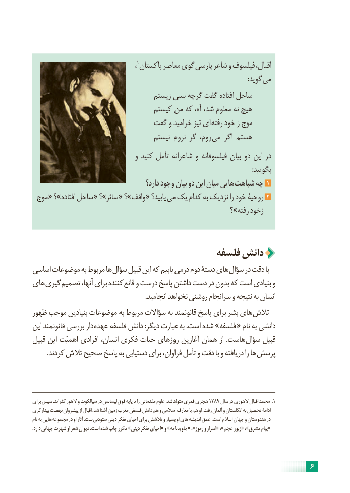

# PDF page 12

،1پاکستان معاصر گوی پارسی شاعر و فیلسوف اقبال،
                         : گوید می
                                   زیستم بسی گرچه گفت افتاده ساحل
                                 کیستم من که آه، شد، معلوم نه هیچ
                           گفت و خرامید تیز ای رفته خود ز موج
                                     نیستم نروم گر روم،  می اگر هستم
                                و کنید تأمل شاعرانه و فیلسوفانه بیان دو این در
                                                                                                                                :بگویید
                                          دارد؟ وجود بیان دو این میان هایی شباهت چه 1
 موج « ؟»افتاده ساحل « ؟»سائر « ؟»واقف « یابید؟ می یک کدام به نزدیک را خود روحیۀ 2
                                                                ؟»رفته زخود

                                       فلسفه دانش
اساسی موضوعات به مربوط ها سؤال قبیل این که یابیم درمی دوم دستۀ های سؤال در دقت با
های گیری تصمیم آنها، برای کننده قانع و درست پاسخ داشتن دست در بدون که است بنیادی و
                                                                  .انجامید نخواهد روشنی سرانجام و نتیجه به انسان
ظهور موجب بنیادین موضوعات به مربوط سؤاالت به قانونمند پاسخ برای بشر های تالش
این قانونمند بررسی دار عهده فلسفه دانش :دیگر عبارت به .است شده »فلسفه « نام به دانشی
قبیل این اهمیّت افرادی انسان، فکری حیات روزهای آغازین همان از .هاست سؤال قبیل
        .کردند تالش صحیح پاسخ به دستیابی برای فراوان، تأمل و دقت با و دریافته را ها پرسش

برای سپس .گذراند الهور و سیالکوت در لیسانس فوق پایه تا را مقدماتی علوم .شد متولد قمری هجری 1289 سال در الهوری اقبال محمد .1
بیدارگری نهضت پیشروان از اقبال .شد آشنا زمین مغرب فلسفی دانش هم و اسالمی معارف با هم او .رفت آلمان و انگلستان به تحصیل ادامۀ
نام به هایی مجموعه در او آثار .ست ستودنی دینی تفکر احیای برای تالشش و بسیار او های اندیشه عمق .است اسالم جهان و هندوستان در
.دارد جهانی شهرت او شعر دیوان .است شده چاپ مکرر »دینی تفکر احیای« و »جاویدنامه« ،»رموز و اسرار« ،»عجم زبور« ،»مشرق پیام«

                                                                     6

