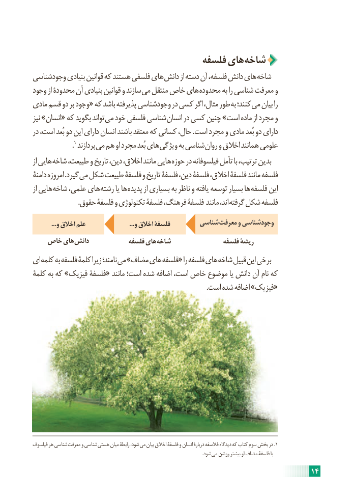

# PDF page 20

فلسفه های  شاخه
وجودشناسی بنیادی قوانین که هستند فلسفی های دانش از دسته آن فلسفه، دانش های شاخه
وجود از محدودۀ آن بنیادی قوانین و سازند می منتقل خاص های محدوده به را شناسی معرفت و
مادی قسم دو بر وجود« که باشد پذیرفته وجودشناسی در کسی اگر مثال، طور به کنند؛ می بیان را
نیز »انسان« که بگوید تواند می خود فلسفی شناسی انسان در کسی چنین »است ماده از مجرد و
در است، بُعد دو این دارای انسان باشند معتقد که کسانی حال، .است مجرد و مادی بُعد دو دارای
                   .1 پردازند می هم او مجرد بُعد های ویژگی به شناسی روان و اخالق همانند علومی
از هایی شاخه طبیعت، و تاریخ دین، اخالق، مانند هایی حوزه در فیلسوفانه تأمل با ترتیب، بدین
دامنۀ امروزه .گیرد می شکل طبیعت فلسفۀ و تاریخ فلسفۀ دین، فلسفۀ اخالق، فلسفۀ مانند فلسفه
از هایی شاخه علمی، های رشته یا ها پدیده از بسیاری به ناظر و یافته توسعه بسیار ها فلسفه این
 . حقوق فلسفۀ و تکنولوژی فلسفۀ فرهنگ، فلسفۀ مانند اند، گرفته شکل فلسفه

           ...و اخالق علم                          ...و اخالق فلسفۀ        شناسی  معرفت و وجودشناسی
   خاص های  دانش            فلسفه های شاخه                فلسفه ریشۀ
ای کلمه به فلسفه کلمۀ زیرا نامند؛ می »مضاف های فلسفه« را فلسفه های شاخه قبیل این برخی
کلمۀ به که »فیزیک فلسفۀ« مانند است؛ شده اضافه است، خاص موضوع یا دانش آن نام که
                                                                                                     .است شده اضافه »فیزیک«

فیلسوف هر شناسی  معرفت و شناسی  هستی میان رابطۀ شود، می بیان اخالق فلسفۀ و انسان دربارۀ فالسفه دیدگاه که کتاب سوم بخش در .1
                                                                                                                                                   .شود می روشن بیشتر او مضاف فلسفۀ با

                                                                     14

