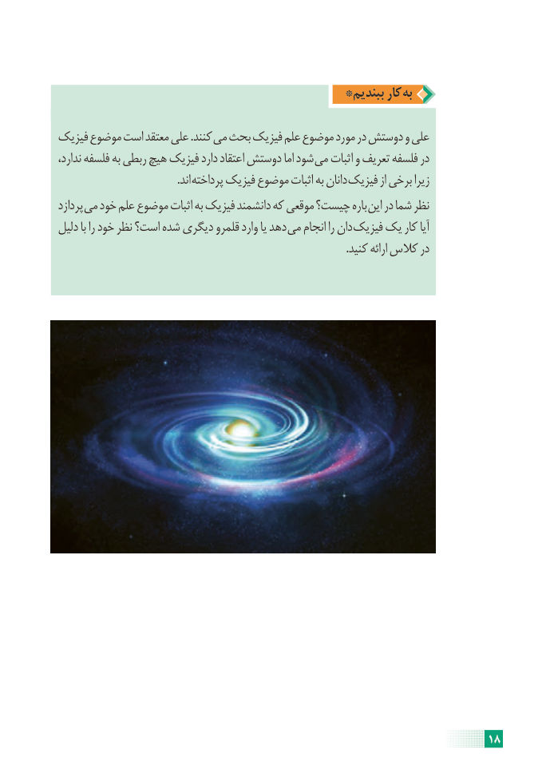

# PDF page 24

*ببندیم کار به

فیزیک موضوع است معتقد علی .کنند می بحث فیزیک علم موضوع مورد در دوستش و علی
ندارد، فلسفه به ربطی هیچ فیزیک دارد اعتقاد دوستش اما شود می اثبات و تعریف فلسفه در
              . اند پرداخته فیزیک موضوع اثبات به دانان فیزیک از برخی زیرا
پردازد می خود علم موضوع اثبات به فیزیک دانشمند که موقعی چیست؟ باره این در شما نظر
دلیل با را خود نظر است؟ شده دیگری قلمرو وارد یا دهد می انجام را دان فیزیک یک کار آیا
                                                                                                          .کنید ارائه کالس در

                                                                    18

