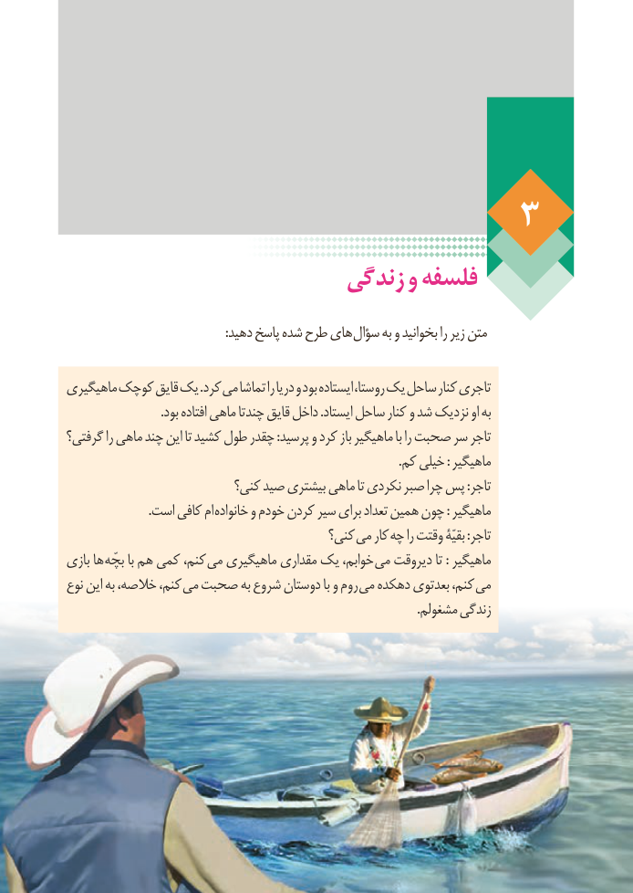

# PDF page 25

زندگی و فلسفه

   : دهید پاسخ شده طرح های سؤال به و بخوانید را زیر متن

 ماهیگیری کوچک قایق یک .کرد می تماشا را دریا و بود ایستاده روستا، یک ساحل کنار تاجری
                                .بود افتاده ماهی چندتا قایق داخل .ایستاد ساحل کنار و شد نزدیک او به
 گرفتی؟ را ماهی چند این تا کشید طول چقدر :پرسید و کرد باز ماهیگیر با را صحبت سر تاجر
                                                                                                             .کم خیلی : ماهیگیر
                          کنی؟ صید بیشتری ماهی تا نکردی صبر چرا پس :تاجر
   . است کافی ام خانواده و خودم کردن سیر برای تعداد همین چون : ماهیگیر
                                        کنی؟ می کار چه را وقتت بقیّۀ :تاجر
 بازی ها بچّه با هم کمی کنم، می ماهیگیری مقداری یک خوابم، می دیروقت تا : ماهیگیر
 نوع این به خالصه، کنم، می صحبت به شروع دوستان با و روم می دهکده بعدتوی کنم، می
                                                                                                                   .مشغولم زندگی

19

