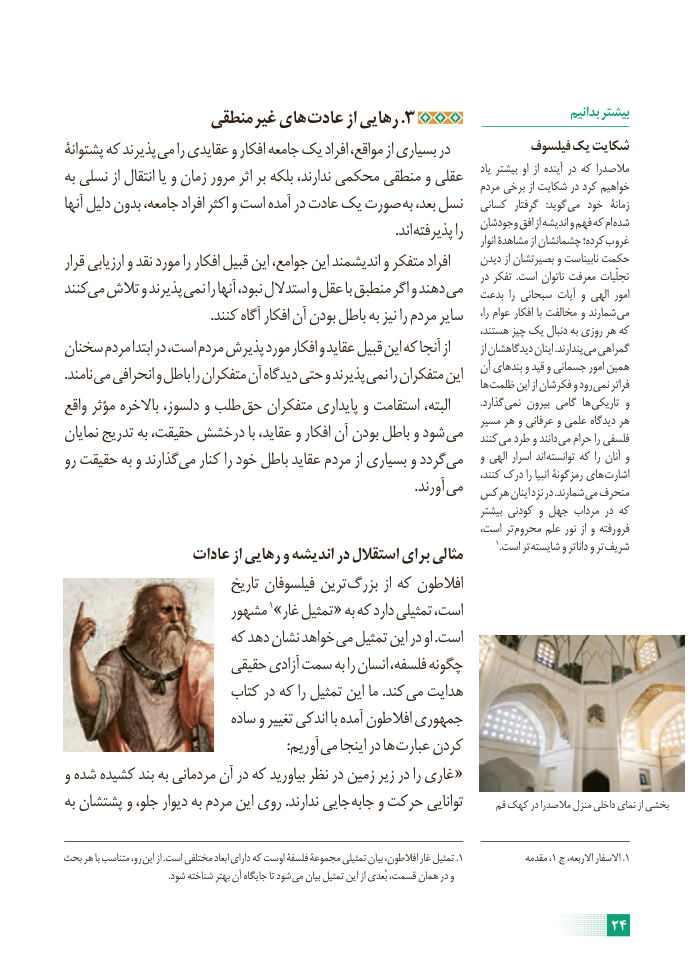

# PDF page 30

منطقی غیر های .عادت از رهایی 3                                بدانیم بیشتر
پشتوانۀ که پذیرند می را عقایدی و افکار جامعه یک افراد مواقع، از بسیاری در            فیلسوف یک شکایت
به نسلی از انتقال یا و زمان مرور اثر بر بلکه ندارند، محکمی منطقی و عقلی     یاد بیشتر او از آینده در که مالصدرا                                                                                     مردم برخی از شکایت در کرد خواهیم
آنها دلیل بدون جامعه، افراد اکثر و است آمده در عادت یک صورت به بعد، نسل   کسانی  گرفتار   :گوید می خود  زمانۀ
                               . اند پذیرفته را   وجودشان افق از اندیشه و فهم که ام شده                                                                                                                                      انوار مشاهدۀ از چشمانشان کرده؛ غروب
قرار ارزیابی و نقد مورد را افکار قبیل این جوامع، این اندیشمند و متفکر افراد      دیدن از بصیرتشان و نابیناست حکمت                                                                                               در تفکر  .است ناتوان معرفت تجلّیاتکنندمی   تالش و پذیرند نمی را آنها نبود، استدالل و عقل با منطبق اگر و دهند می   بدعت  را سبحانی آیات و الهی امور
                                           .کنند آگاه افکار آن بودن باطل به نیز را مردم سایر      را، عوام افکار با مخالفت و شمارند می                                                                                       هستند، چیز یک دنبال به روزی هر که
سخنان مردم ابتدا در است، مردم پذیرش مورد افکار و عقاید قبیل این که آنجا از          از دیدگاهشان اینان .پندارند می گمراهی
. نامند می انحرافی و باطل را متفکران آن دیدگاه حتی و پذیرند نمی را متفکران این   آن بندهای و قید و جسمانی امور همین                                                                                              ها ظلمت این از فکرشان و رود نمی فراتر
واقع مؤثر باالخره دلسوز، و طلب حق متفکران پایداری و استقامت البته،            .گذارد نمی بیرون گامی ها تاریکی و                                                                                 مسیر هر و عرفانی و علمی دیدگاه هرنمایان تدریج به حقیقت، درخشش با عقاید، و افکار آن بودن باطل و شود می    کنند می طرد و دانند می حرام را فلسفی
رو حقیقت به و گذارندمی    کنار را خود باطل عقاید مردم از بسیاری و گرددمی       و الهی اسرار اند توانسته که را آنان و                                                                                                      کنند، درک را انبیا رمزگونۀ های اشارت                    . آورند می  هرکس اینان نزد در .شمارند می منحرف
                                                                                               بیشتر کودنی و جهل مرداب در که
                                                                             است، تر محروم علم نور از و رفته فرو
                                                                                                                                                    1.است تر شایسته و داناتر و تر شریف                 عادات از رهایی و اندیشه در استقالل برای مثالی
                              تاریخ فیلسوفان ترین بزرگ از که افالطون
                       مشهور 1»غار تمثیل « به که دارد تمثیلی است،
                       که دهد نشان خواهد می تمثیل این در او .است
                       حقیقی آزادی سمت به را انسان فلسفه، چگونه
                       کتاب در که را تمثیل این ما .کند می هدایت
                          ساده و تغییر اندکی با آمده افالطون جمهوری
            : آوریم می اینجا در ها عبارت کردن
و شده کشیده بند به مردمانی آن در که بیاورید نظر در زمین زیر در را غاری «
به پشتشان و جلو، دیوار به مردم این روی .ندارند جایی جابه و حرکت توانایی       قم کهک در مالصدرا منزل داخلی نمای از بخشی

بحث هر با متناسب رو، این از .است مختلفی ابعاد دارای که اوست فلسفۀ مجموعۀ تمثیلی بیان افالطون، غار تمثیل .1              مقدمه ،1 ج االربعه، االسفار .1
                                              .شود شناخته بهتر آن جایگاه تا شود می بیان تمثیل این از بُعدی قسمت، همان در و

                                                                     24

