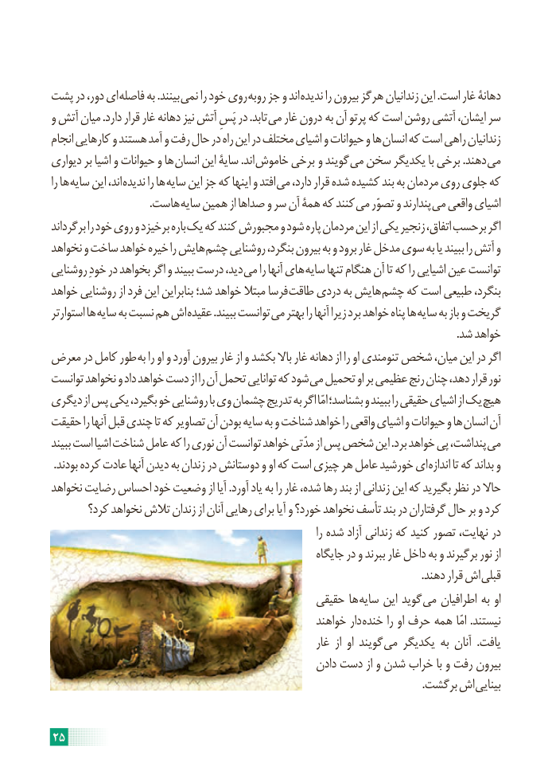

# PDF page 31

پشت در دور، ای فاصله به .بینند نمی را خود روی روبه جز و اند ندیده را بیرون هرگز زندانیان این .است غار دهانۀ
و آتش میان .دارد قرار غار دهانه نیز آتش پَسِ در .تابد می غار درون به آن پرتو که است روشن آتشی ایشان، سر
انجام کارهایی و هستند آمد و رفت حال در راه این در مختلف اشیای و حیوانات و ها انسان که است راهی زندانیان
دیواری بر اشیا و حیوانات و ها انسان این سایۀ .اند خاموش برخی و گویند می سخن یکدیگر با برخی .دهند می
را ها سایه این اند، ندیده را ها سایه این جز که اینها و افتد می دارد، قرار شده کشیده بند به مردمان روی جلوی که
      . هاست سایه همین از صداها و سر آن همۀ که کنند می تصوّر و پندارند می واقعی اشیای
برگرداند را خود روی و برخیزد باره یک که کنند مجبورش و شود پاره مردمان این از یکی زنجیر اتفاق، برحسب اگر
نخواهد و ساخت خواهد خیره را هایش چشم روشنایی بنگرد، بیرون به و برود غار مدخل سوی به یا ببیند را آتش و
روشنایی خودِ در بخواهد اگر و ببیند درست دید، می را آنها های سایه تنها هنگام آن تا که را اشیایی عین توانست
خواهد روشنایی از فرد این بنابراین شد؛ خواهد مبتال فرسا طاقت دردی به هایش چشم که است طبیعی بنگرد،
استوارتر ها سایه به نسبت هم اش عقیده .ببیند توانست می بهتر را آنها زیرا برد خواهد پناه ها سایه به باز و گریخت
                                                                                                                                                      .شد خواهد
معرض در کامل طور به را او و آورد بیرون غار از و بکشد باال غار دهانه از را او تنومندی شخص میان، این در اگر
توانست نخواهد و داد خواهد دست از را آن تحمل توانایی که شود می تحمیل او بر عظیمی رنج چنان دهد، قرار نور
دیگری از پس یکی بگیرد، خو روشنایی با وی چشمان تدریج به اگر امّا بشناسد؛ و ببیند را حقیقی اشیای از یک هیچ
حقیقت را آنها قبل چندی تا که تصاویر آن بودن سایه به و شناخت خواهد را واقعی اشیای و حیوانات و ها انسان آن
ببیند است اشیا شناخت عامل که را نوری آن توانست خواهد مدّتی از پس شخص این .برد خواهد پی پنداشت، می
. بودند کرده عادت آنها دیدن به زندان در دوستانش و او که است چیزی هر عامل خورشید ای اندازه تا که بداند و
نخواهد رضایت احساس خود وضعیت از آیا .آورد یاد به را غار شده، رها بند از زندانی این که بگیرید نظر در حاال
       کرد؟ نخواهد تالش زندان از آنان رهایی برای آیا و خورد؟ نخواهد تأسف بند در گرفتاران حال بر و کرد
                                                                                را شده آزاد زندانی که کنید تصور نهایت، در
                                                         جایگاه در و ببرند غار داخل به و برگیرند نور از
            . دهند قرار اش قبلی
                                              حقیقی ها سایه این گوید می اطرافیان به او
                                                    خواهند دار خنده را او حرف همه امّا .نیستند
                                                          غار  از او گویند می یکدیگر به آنان  .یافت
                                                    دادن دست از و شدن خراب با و رفت بیرون
             . برگشت اش بینایی

25

