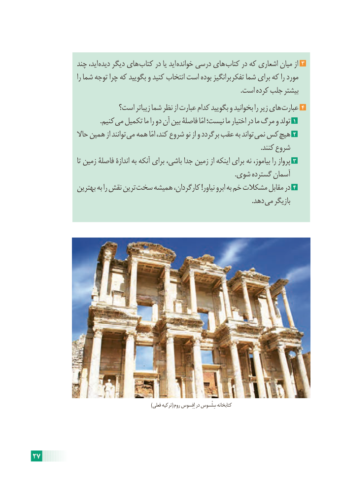

# PDF page 33

چند اید، دیده دیگر های کتاب در یا اید خوانده درسی های کتاب در که اشعاری میان از  3
                     را شما توجه چرا که بگویید و کنید انتخاب است بوده برانگیز تفکر شما برای که را مورد
                                                                                                                            .است کرده جلب بیشتر
                      است؟ زیباتر شما نظر از عبارت کدام بگویید و بخوانید را زیر های عبارت 4
                                        .کنیم می تکمیل ما را دو آن بین فاصلۀ امّا نیست؛ ما اختیار در ما مرگ و تولد 1
                حاال همین از توانند می همه امّا کند، شروع نو از و برگردد عقب به تواند نمی کس هیچ 2
                                                                                                                                        .کنند شروع
                      تا زمین فاصلۀ اندازۀ به آنکه برای باشی، جدا زمین از اینکه برای نه بیاموز، را پرواز 3
                                                                                                                        .شوی گسترده آسمان
              بهترین به را نقش ترین سخت همیشه کارگردان، !نیاور ابرو به خم مشکالت مقابل در 4
                                                                                                                                   .دهد می بازیگر

           )(فعلی ترکیه  روم اِفِسوس در سِلْسوس کتابخانه

27

