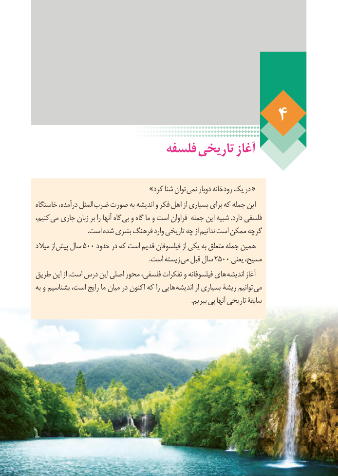

# PDF page 34

فلسفه تاریخی آغاز

                            »کرد شنا توان نمی دوبار رودخانه یک در «
خاستگاه درآمده، المثل ضرب صورت به اندیشه و فکر اهل از بسیاری برای که جمله این
کنیم، می جاری زبان بر را آنها گاه بی و گاه ما و است فراوان جمله این شبیه .دارد فلسفی
                                .است شده بشری فرهنگ وارد تاریخی چه از ندانیم است ممکن گرچه
میالد از پیش سال 500 حدود در که است قدیم فیلسوفان از یکی به متعلق جمله همین
       . است زیسته می قبل سال 2500 یعنی مسیح،
طریق این از .است درس این اصلی محور فلسفی، تفکرات و فیلسوفانه های اندیشه آغاز
به و بشناسیم است، رایج ما میان در اکنون که را هایی اندیشه از بسیاری ریشۀ توانیم می
                                                                                              .ببریم پی آنها تاریخی سابقۀ

                                                                    28

