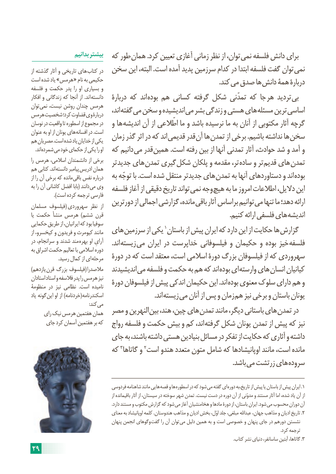

# PDF page 35

بدانیم بیشتر                      که طور همان .کرد تعیین آغازی زمانی نظر از توان، نمی فلسفه دانش برای
از گذشته آثار و تاریخی های کتاب در  سخن این البته، .است آمده پدید سرزمین کدام در ابتدا فلسفه گفت توان نمی
است شده یاد »هرمس  « نام به حکیمی                 . کند می صدق ها دانش همۀ دربارۀفلسفه و حکمت پدر را او بسیاری و
افکار و زندگانی که آنجا از .اند  دانسته   دربارۀ که اند بوده هم کسانی گرفته شکل تمدّنی که جا هر تردید بی
توان نمی نیست، روشن چندان هرمس    اند، گفته می سخن و اندیشیده می بشر زندگی و هستی های مسئله ترین اساسیهرمس شخصیت کرد؛ قضاوت وی دربارۀ
نوسان در واقعیت تا اسطوره از مجموع در   و ها اندیشه آن از اطّالعی ما و باشد نرسیده ما به آنان از مکتوبی آثار گرچه
عنوان به او از یونان های افسانه در .است   زمان گذر اثر در که اند قدیمی قدر آن ها تمدن از برخی .باشیم نداشته ها سخنهم مصریان .است شده یاد خدایان از یکی
 . اند شمرده می خود حکمای از یکی را او  که دانیم می قدر همین .است رفته بین از آنها تمدنی آثار حوادث، شد و آمد و
را هرمس اسالمی، دانشمندان از برخی   تر جدید های تمدن گیری شکل پلکان و مقدمه تر، ساده و تر قدیم های تمدنهم کتابی .اند دانسته پیامبر ادریس همان
از را آن برخی که مانده باقی نفس درباره   به توجّه با .است شده منتقل جدیدتر های تمدن به آنها دستاوردهای و اند بوده
به را آن کاشانی افضل بابا( دانند می وی   فلسفه آغاز از دقیقی تاریخ تواند نمی وجه هیچ به ما امروز اطالعات دالیل، این                ).است کرده ترجمه فارسی                          دورترین از اجمالی گزارشی مانده، باقی آثار براساس توانیم می تنها ما دهد؛ ارائهمسلمان فیلسوف( سهروردی نظر  از
یا حکمت منشأ هرمس  )ششم قرن    . کنیم ارائه فلسفی های اندیشه
حکمایی طریق از ایرانیان، که بود سوفیا
از کیخسرو، و فریدون و کیومرث مانند  های سرزمین از یکی 1باستان از پیش ایران که دارد این از حکایت ها گزارش
در سرانجام، و شدند مند  بهره او آرایِ     .اند زیسته می ایران در خداپرست فیلسوفانی و حکیمان و بوده خیز فلسفهبه اشراق حکمت تعالیم با اسالمی دوره
  . رسید کمال از ای مرحله   دورۀ در که است معتقد است، اسالمی دورۀ بزرگ فیلسوفان از که سهروردی
)یازدهم (قرن بزرگ فیلسوف  مالصدرا   اندیشیدند می فلسفه و حکمت به هم که اند بوده ای وارسته های انسان کیانیان
استادان استاد و فالسفه پدر را هرمس نیز   دورۀ فیلسوفان از پیش اندکی حکیمان این .اند بوده معنوی سلوک دارای هم ومنظومۀ در  نیز نظامی  .است نامیده
یاد گونه (این او از )خردنامه  اسکندرنامه          . اند زیسته می آنان از پس و زمان هم نیز برخی و باستان یونان
            : کند می
     رای نیک هرمس هفتمین همان  مصر و النهرین بین هند، چین، های تمدن مانند دیگر، باستانی های تمدن در
     جای کرد آسمان هفتمین بر که   رواج فلسفه و حکمت بیش و کم اند، گرفته شکل یونان تمدن از پیش که نیز
                    جای به باشند، داشته هستی بنیادین مسائل در تفکر از حکایت که آثاری و داشته
                      که 3گاتاها و 2است هندو متعدد متون شامل که اوپانیشادها مانند است، مانده
                          . باشد می زرتشت های سروده

                                 فردوسی شاهنامه مانند هایی  قصه و ها اسطوره در که شود می گفته ای  .دوره تاریخ،به از پیش یا باستان از پیش ایران 1
                                                           از باقیمانده آثار از سیستان، در سوخته شهر تمدن .نیست دست در دوره آن از مدوّنی و مستند آثار اما شده، یاد آن از
   . دارد مستند و مکتوب گزارش که شود می آغاز هخامنشیان و مادها دورۀ از باستان، ایران .شود  می محسوب دوران آن
                                     معنای به اوپانیشاد کلمه .هندوستان مذاهب و ادیان بخش اوّل، جلد مبلغی، عبداهلل جهان، مذاهب و ادیان تاریخ .2
                                        پنهان انجمن وگوهای گفت را آن توان  می دلیل همین به و است خصوصی و پنهان جای در دورهم نشستن
                                                                                                                                                                                                                                   .کرد ترجمه
      .3کتاب نشر دنیای ساسانفر، آبتین گاتاها، .
29

