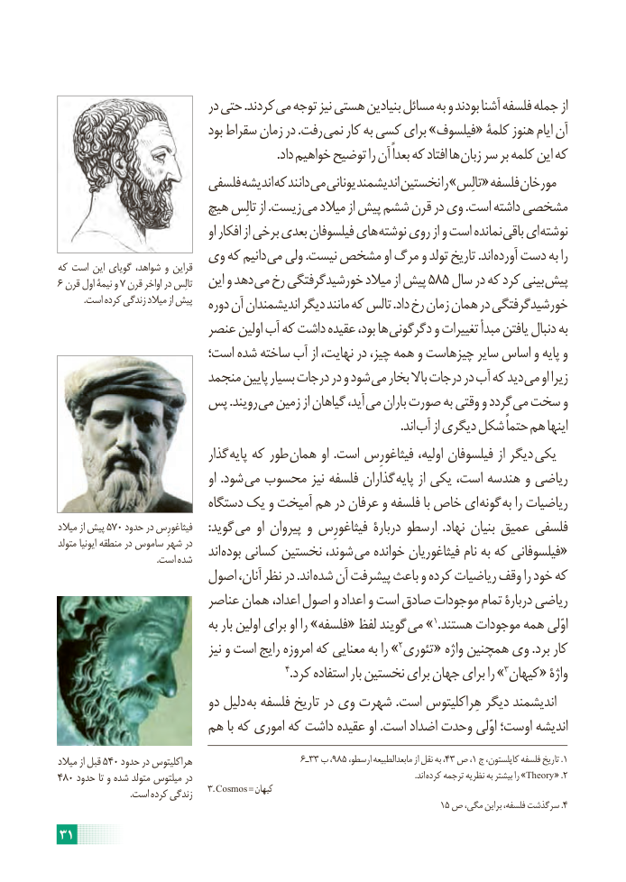

# PDF page 37

در حتی .کردند می توجه نیز هستی بنیادین مسائل به و بودند آشنا فلسفه جمله از
                               بود سقراط زمان در .رفت نمی کار به کسی برای »فیلسوف« کلمۀ هنوز ایام آن
  . داد خواهیم توضیح را آن بعداً که افتاد ها زبان سر بر کلمه این که
                       فلسفی اندیشه که دانند می یونانی اندیشمند نخستین را »تالِس« فلسفه مورخان
                      هیچ تالِس از .زیست می میالد از پیش ششم قرن در وی .است داشته مشخصی
                                      او افکار از برخی بعدی فیلسوفان های نوشته روی از و است نمانده باقی ای نوشته
                  وی که دانیم می ولی .نیست مشخص او مرگ و تولد تاریخ .اند آورده دست به راکه است این گویای شواهد، و قراین
6 قرن اول نیمۀ و 7 قرن اواخر در تالِس   این و دهد می رخ خورشیدگرفتگی میالد از پیش 585 سال در که کرد بینی پیش
           .است کرده زندگی میالد از پیش   دوره آن اندیشمندان دیگر مانند که تالس .داد رخ زمان همان در خورشیدگرفتگی
                      عنصر اولین آب که داشت عقیده بود، ها دگرگونی و تغییرات مبدأ یافتن دنبال به
                       است؛ شده ساخته آب از نهایت، در چیز، همه و چیزهاست سایر اساس و پایه و
                       منجمد پایین بسیار درجات در و شود می بخار باال درجات در آب که دید می او زیرا
                پس .رویند می زمین از گیاهان آید، می باران صورت به وقتی و گردد می سخت و
                                    . اند آب از دیگری شکل حتماً هم اینها
                             گذار پایه که طور همان او .است فیثاغورِس اولیه، فیلسوفان از دیگر یکی
                                     او .شود می محسوب نیز فلسفه گذاران پایه از یکی است، هندسه و ریاضی
                          دستگاه یک و آمیخت هم در عرفان و فلسفه با خاص ای گونه به را ریاضیات
میالد از پیش 570 حدود در فیثاغورِس     :گوید می او پیروان و فیثاغورِس دربارۀ ارسطو  .نهاد بنیان عمیق فلسفی
متولد ایونیا منطقه در ساموس شهر در    اند بوده کسانی نخستین شوند، «می خوانده فیثاغوریان نام به که فیلسوفانی                                           .است شده
                     اصول آنان، نظر در .اند شده آن پیشرفت باعث و کرده ریاضیات وقف را خود که
                        عناصر همان  ،ریاضیاعداد اصول و اعداد و است صادق موجودات تمام دربارۀ
                              به بار اولین برای او را »فلسفه« لفظ گویند »می   1.هستند موجودات همه اوّلی
                                  نیز و است رایج امروزه که معنایی به را » 2تئوری « واژه همچنین وی .برد کار
   4.»کرد استفاده بار نخستین برای جهان برای را  3کیهان« واژۀ
                           دو دلیل به فلسفه تاریخ در وی شهرت .است هِراکلیتوس دیگر اندیشمند
                   هم با که اموری که داشت عقیده او .است اضداد وحدت اوّلی اوست؛ اندیشه
میالد از قبل 540 حدود در هراکلیتوس                      6ـ33 ب ،985 ،،ارسطو مابعدالطبیعه از نقل به 43 ص ،1 ج کاپلستون، فلسفه تاریخ .1
480 حدود تا و شده متولد میلتوس در                                                                                                             .اند  »کرده ترجمه نظریه به بیشتر را Theory« .2
                                .است کرده زندگی    3. Cosmos = کیهان                                                                               15 ص مگی، براین فلسفه، سرگذشت .4
31

