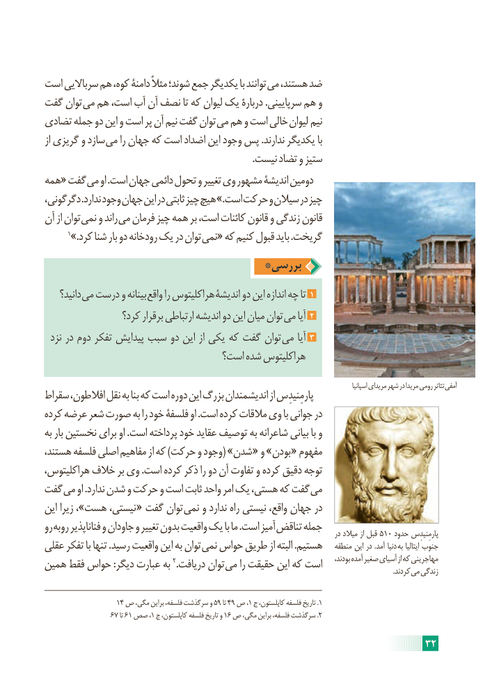

# PDF page 38

است سرباالیی هم کوه، دامنۀ مثالً شوند؛ جمع یکدیگر با توانند می هستند، ضد
گفت توان می هم است، آب آن نصف تا که لیوان یک دربارۀ .سرپایینی هم و
تضادی جمله دو این و است پر آن نیم گفت توان می هم و است خالی لیوان نیم
از گریزی و سازد می را جهان که است اضداد این وجود پس .ندارند یکدیگر با
                                                                                        .نیست تضاد و ستیز
همه« گفت می او .است جهان دائمی تحول و تغییر وی مشهور اندیشۀ دومین
دگرگونی، .ندارد وجود جهان این در ثابتی چیز هیچ .»است حرکت و سیالن در چیز
آن از توان نمی و راند می فرمان چیز همه بر است، کائنات قانون و زندگی قانون
      1».کرد شنا بار دو رودخانه یک در توان نمی« که کنیم قبول باید .گریخت
                                 *بررسی
    دانید؟ می درست و بینانه واقع را هراکلیتوس اندیشۀ دو این اندازه چه تا 1
                 کرد؟ برقرار ارتباطی اندیشه دو این میان توان می آیا 2
  نزد در دوم تفکر پیدایش سبب دو این از یکی که گفت توان می آیا 3
                                است؟ شده هراکلیتوس

                                                                                                                                               اسپانیا مریدای شهر در مریدا رومی تئاتر آمفی
سقراط افالطون، نقل به بنا که است دوره این بزرگ اندیشمندان از پارمِنیدِس
کرده عرضه شعر صورت به را خود فلسفۀ او .است کرده مالقات وی با جوانی در
به بار نخستین برای او .است پرداخته خود عقاید توصیف به شاعرانه بیانی با و
هستند، فلسفه اصلی مفاهیم از که )حرکت و وجود( »شدن « و »بودن « مفهوم
هراکلیتوس، خالف بر وی .است کرده ذکر را دو آن تفاوت و کرده دقیق توجه
گفت می او .ندارد شدن و حرکت و است ثابت واحد امر یک هستی، که گفت می
این زیرا ،»هست نیستی، « گفت توان نمی و ندارد راه نیستی واقع، جهان در
رو روبه فناناپذیر و جاودان و تغییر بدون واقعیت یک با ما .است آمیز تناقض جمله                                                                                               در میالد از قبل 510 حدود پارمِنیدِس
عقلی تفکر با تنها .رسید واقعیت این به توان نمی حواس طریق از البته .هستیم   منطقه این در .آمد دنیا به ایتالیا جنوب
همین فقط حواس :دیگر عبارت به 2.دریافت توان می را حقیقت این که است     بودند، آمده صغیر آسیای از که مهاجرینی                                   . کردند می زندگی

                   14 ص مگی، براین فلسفه، سرگذشت و 59 تا 49 ص ،1 ج کاپلستون، فلسفه تاریخ .1
                  67 تا 61 صص ،1 ج کاپلستون، فلسفه تاریخ و 16 ص مگی، براین فلسفه، سرگذشت .2

                                                                     32

