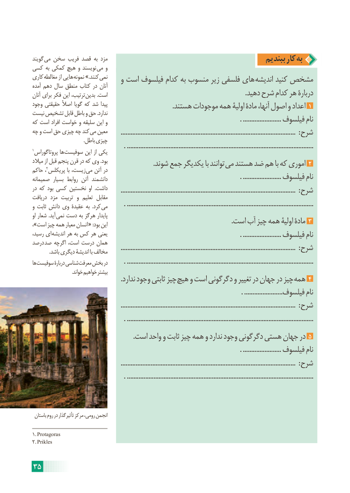

# PDF page 41

گویند می سخن فریب قصد به مزد                                                ببندیم کار به
کسی به کمکی هیچ و نویسند  می و
کاری  مغالطه از هایی نمونه .»کنند نمی    و است فیلسوف کدام به منسوب زیر فلسفی های اندیشه کنید مشخصآمده دهم سال منطق کتاب در آنان
آنان برای فکر این ترتیب، بدین .است                                                                                .دهید شرح کدام هر دربارۀ
وجود حقیقتی اصالً گویا که شد پیدا                                      .هستند موجودات همه اولیۀ مادۀ آنها، اصول و اعداد 1
نیست تشخیص قابل باطل و حق .ندارد
که است افراد خواست و سلیقه این و                                                                             . ....................... فیلسوف نام
چه و است حق چیزی چه کند می معین        ......................................................................................................... : شرح
                                        .باطل چیزی
1                                                    . ................................................................................................................ پروتاگوراس ها سوفیست این از یکی
میالد از قبل پنجم قرن در که وی .بود        2   . شوند جمع یکدیگر با توانند می هستند ضد هم با که اموری 2حاکم ، پریکلس با زیست، می آتن در
صمیمانه  بسیار روابط آتن دانشمند                                                                             . ....................... فیلسوف نام
در که بود کسی نخستین او  .داشت       ......................................................................................................... : شرح
دریافت مزد تربیت و  تعلیم  مقابل
و ثابت دانش وی عقیدۀ به  .کرد می         . ................................................................................................................
او شعار .آید نمی دست به هرگز پایدار
،»است چیز همه معیار انسان « :بود این                                                                        .است آب چیز همه اولیۀ مادۀ 3
رسید، ای اندیشه هر به کس هر یعنی                                                                             . ....................... فیلسوف نام
درصد صد اگرچه است، درست همان
             .باشد دیگری اندیشۀ با مخالف        ......................................................................................................... : شرح
ها سوفیست دربارۀ شناسی معرفت بخش در         . ................................................................................................................
                                  .خواند خواهیم بیشتر
   . ندارد وجود ثابتی چیز هیچ و است دگرگونی و تغییر در جهان در چیز همه 4
                                                                                                                          . .......................فیلسوف نام
                                                   ......................................................................................................... : شرح
                                                     . ................................................................................................................
                                                           .است واحد و ثابت چیز همه و ندارد وجود دگرگونی هستی جهان در 5
                                                                                                                         . ....................... فیلسوف نام
                                                   ......................................................................................................... : شرح
                                                     . ................................................................................................................

 باستان روم در تأثیرگذار مرکز رومی، انجمن

1.  Protagoras
2.  Prikles

35

