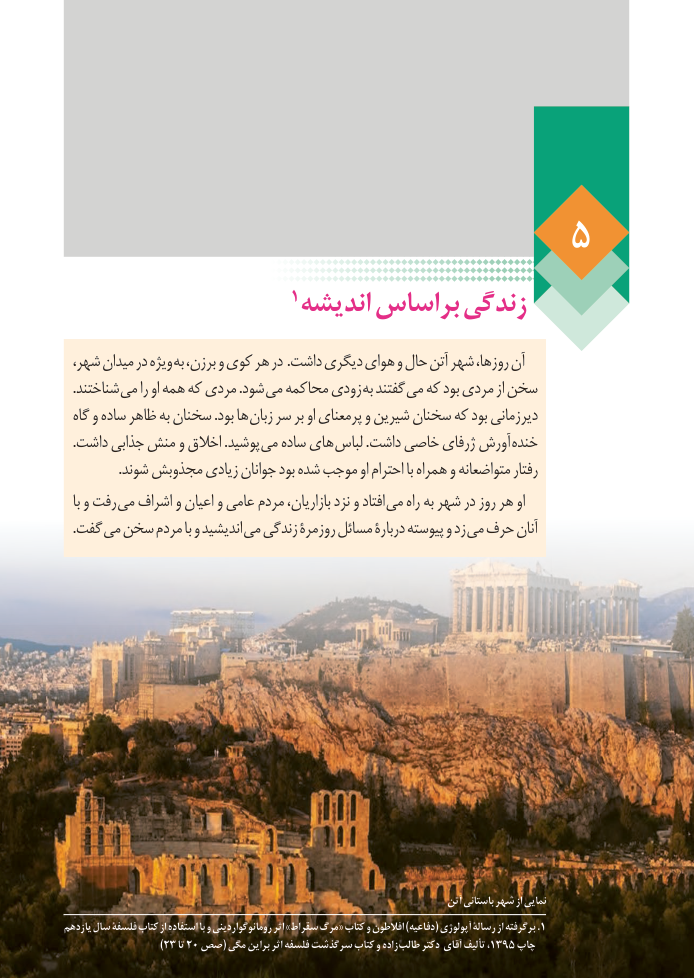

# PDF page 42

1اندیشه براساس زندگی
،ویژهشهر میدان در      به برزن، و کوی هر در .داشت دیگری هوای و حال آتن شهر روزها، آن
   .شناختند می را او همه که مردی .شود می محاکمه زودی به گفتند می که بود مردی از سخن
  گاه و ساده ظاهر به سخنان .بود ها زبان سر بر او پرمعنای و شیرین سخنان که بود دیرزمانی
   .داشت جذابی منش و اخالق .پوشید می ساده های لباس .داشت خاصی ژرفای آورش خنده
                .شوند مجذوبش زیادی جوانان بود شده موجب او احترام با همراه و متواضعانه رفتار
  با و رفت می اشراف و اعیان و عامی مردم بازاریان، نزد و افتاد می راه به شهر در روز هر او
   .گفت می سخن مردم با و اندیشید می زندگی روزمرۀ مسائل دربارۀ پیوسته و زد می حرف آنان

                                                                               آتن باستانی شهر از نمایی
یازدهم سال فلسفۀ کتاب از استفاده با و رومانوگواردینی اثر »سقراط مرگ« کتاب و افالطون )دفاعیه( آپولوژی رسالۀ از برگرفته .1        36
                  )23 تا 20 صص( مگی براین اثر فلسفه سرگذشت کتاب و زاده  طالب دکتر  آقای تألیف ،1395 چاپ

